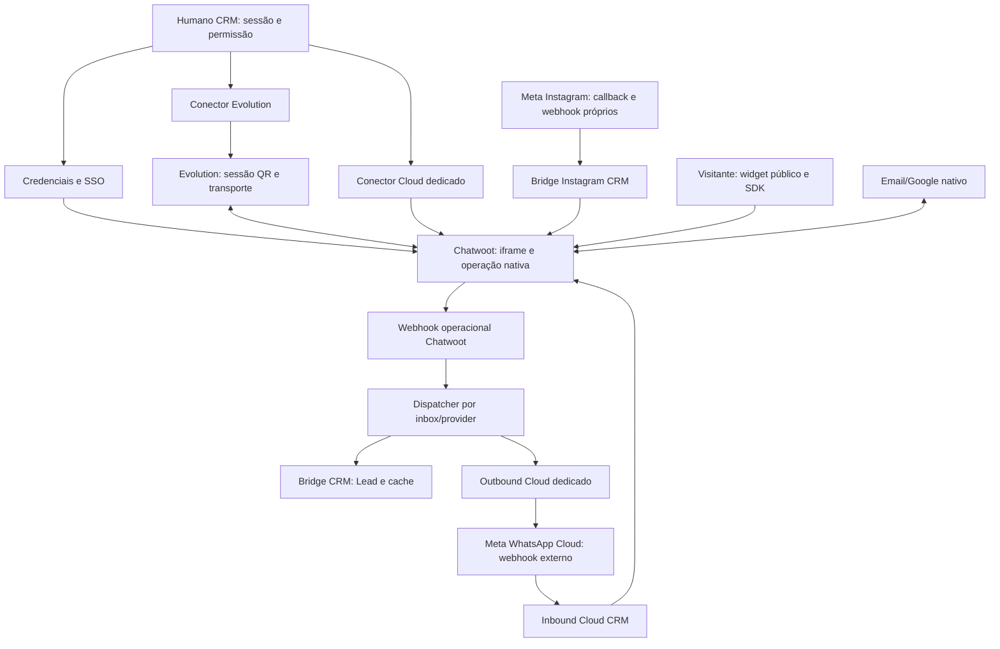

# Bloco 2 — Auditoria técnica de Atendimento

**Data:** 18/10/2026. **Base imutável:** `2649d3f491e27c82e7467709c0796c4f5c92c1d0`. **Branch:** `feature/modular-plans-entitlements`.

**Estado:** auditoria estática e plano documental, sem integração de Atendimento. O manifesto permanece vazio e não há homologação integral do Bloco 2.

## 1. Conclusão e limites da evidência

O módulo combina uma interface humana em iframe, APIs humanas de configuração, funções técnicas internas e entradas externas com autenticações diferentes. Não é seguro inserir o guard de sessão em todas as rotas. Os achados C01–C04 bloqueiam qualquer expansão dos caminhos de recepção/provisionamento que possa agravá-los. Nenhum deles foi corrigido nesta missão; o plano relacionado fica condicionado à revisão específica de segurança e nova autorização, sem interromper a entrega documental.

Inventário principal: **58 arquivos de rota, 72 métodos HTTP** (57 arquivos em /api e um loader público fora de /api), mais **11 páginas**, funções internas e nove arquivos de endpoints compartilhados relacionados (12 métodos adicionais). Nomes não determinam identidade: `/agentes/sync` é ação humana; o webhook é externo; `channel-status` pode escrever mesmo quando chamado por GET. Conversas/mensagens/contatos, atribuição, transferência e filas são majoritariamente operação nativa do Chatwoot, não uma API de conversação paralela do CRM.

Todos os achados são fundamentados no código da base vinculada. Ausência de validação no handler e seus helpers foi verificada por leitura; não se mediu configuração de proxy, valores de env, estado de clientes ou exploração em produção. Não há PoC executada, credencial real usada, chamada de endpoint, mensagem, consulta SQL, sync, conexão ou desconexão nesta auditoria. Severidade considera impacto potencial e pré-condições explícitas, não afirma comprometimento ocorrido.

## 2. Governança consultada e divergências

Os 12 documentos recebidos em `docs/oficiais/` foram lidos nesta sequência de trabalho e consultados para esta auditoria: 00 README, 01 Mestre, 02 Status, 03 Decisões, 04 Arquitetura, 05 Regras, 7 CORE, 8 Providers, 9 Dependências, 10 Checklist, 14 Metodologia e 17 Prisma. Origem/tamanhos/hashes continuam no índice e [ORIGEM](oficiais/ORIGEM.md); nenhum original foi alterado. Base de autorização e compatibilidade: [ADR-001](ADR-001-MODULAR-PLANS-GOVERNANCE.md), [matriz](BLOCK2_ACCESS_MATRIX.md), [relatório anterior](BLOCK2_AUTHORIZATION_REPORT.md), catálogo/resolvedor do Bloco 1 e fonte do motor atual.

- Documentos 01/04/7/8: preservar iframe/credenciais, isolamento tenant, transporte/lifecycle por provider, 1 número WhatsApp = 1 inbox = 1 canal; não reconstruir mensageria/filas no CRM. Risco máximo de alteração em página e credenciais; alto em bridge/webhook/Leads/Pipeline.
- Doc. 03 chama `/api/webhooks/chatwoot` de webhook operacional central. Isso não prova que callbacks de transporte sejam unificáveis: Meta Cloud e Instagram têm entradas próprias, e Evolution se integra nativamente por /chatwoot/set. São camadas distintas; preservar contratos até decisão específica.
- Os snapshots oficiais de maio descrevem estabilidade operacional; o código auditado ainda contém as lacunas abaixo. Não substituir o snapshot nem presumir que estabilidade histórica comprova autenticação atual.
- A definição Cloud é active/safeToUseNow, mas o conector genérico Cloud devolve 501; há conector operacional dedicado. Não resolver a divergência silenciosamente nem criar rota alternativa nesta missão.
- Campos abstratos de canais/quotas futuros não são a representação persistida atual. Não inferir quantidades contratadas nem converter limites legados. Não acrescentar organizationId a filhos por mera redação geral do doc. 17.
- Exemplos de push main/deploy/teste real do doc. 14 não ampliam esta autorização: somente branch existente, três documentos editoriais, nenhum runtime/migração/provider/produção/enforcement/Bloco 3. Referências adicionais ausentes do pacote continuam ausentes, sem conteúdo presumido.

## 3. Identidades e fronteiras

| Categoria | Identidade real e autoridade tenant | Aplicação futura permitida apenas após aprovação |
| --- | --- | --- |
| A — humana | NextAuth + checkPermission/checkAdminAccess; usuário e organização relidos no helper. Tenant da sessão validada. Ações manuais de sync/validate/provision de canal continuam humanas. | Compor autorização comercial observada conservando permissão operacional exata. Página exige autenticação independentemente de observe_only. |
| A-admin — administrativa | Cookie admin-token/JWT separado; tenant alvo explícito do path administrativo. Validações atuais insuficientes de role/existência não devem ser confundidas com o contrato novo preparado. | Autoridade administrativa explícita; não simular login do tenant nem exigir seu entitlement para contenção/remoção administrativa. |
| B — técnica interna | Funções server-side recebem contexto do chamador A ou C. Token API/Platform/Graph/Evolution autentica o CRM ao serviço externo. Parâmetro organizationId isolado não autentica um chamador externo. | Só diagnóstico comercial não bloqueante após autenticação/mapeamento técnico confiável, com falha isolada. O authorizer humano atual não serve diretamente para essa identidade. |
| C — webhook/callback | Identidade técnica do provider e integração vinculada; contratos atuais possuem as falhas C01/C02/H01/H02. Sem cookie de usuário. | Jamais inserir checkModulePermission/checkModulePage/NextAuth como requisito de recebimento. Assinatura/segredo/state e vínculo confiável precisam de revisão própria. |
| P — publicação pública intencional | Loader/config do widget e cadastro inicial são fronteiras públicas, sem fingir sessão ou serviço autenticado. Não se encaixam artificialmente em A/B/C. | Preservar acesso público de widget/handshake; política de publicação própria pendente, sem autorização por websiteToken como se fosse token administrativo. |

Nenhum endpoint dedicado de cron/job autenticado foi encontrado no conjunto rastreado. Não inventar identidade de serviço para funções ou chamar sync manual de job. Chamadas SDK/iframe feitas diretamente ao Chatwoot continuam sob autenticação nativa externa; não se conclui seu isolamento apenas por ocultar menus.

## 4. Inventário verificável de rotas

Cada linha combina os dez campos pedidos: arquivo/linha e método, finalidade, provider, identidade/autenticação, permissão atual, tenant, efeitos, dependências externas, risco de regressão da futura mudança e possibilidade de integração. **Risco de regressão** não é a severidade de uma vulnerabilidade. A1/A2/C/D remetem ao [plano](BLOCK2_ATENDIMENTO_IMPLEMENTATION_PLAN.md); A0 indica bloqueio de segurança. B e P conservam identidades próprias. Onde há vários métodos, as permissões são especificadas por método.

| Arquivo e método HTTP (fonte fixa) | Finalidade | Provider | Identidade/autenticação e permissão atual | Tenant utilizado | Efeitos e dependências | Risco de regressão | Integração futura |
| --- | --- | --- | --- | --- | --- | --- | --- |
| `src/app/api/atendimento/agentes/route.ts` — [GET](https://github.com/mundodigitalsolucoes/mds-crm-saas/blob/2649d3f491e27c82e7467709c0796c4f5c92c1d0/src/app/api/atendimento/agentes/route.ts#L17) | Listar membros CRM ativos e correspondência por ID/e-mail | Chatwoot multicanal | GET A: sessão + checkPermission(atendimento:view) | Sessão validada → organizationId; credencial da conta local | Lê User/ConnectedAccount e agentes via Chatwoot HTTP; sem escrita intencional | Médio | A1 |
| `src/app/api/atendimento/agentes/sync/route.ts` — [POST](https://github.com/mundodigitalsolucoes/mds-crm-saas/blob/2649d3f491e27c82e7467709c0796c4f5c92c1d0/src/app/api/atendimento/agentes/sync/route.ts#L17) | Vincular agentes existentes por e-mail (manual, não job) | Chatwoot multicanal | POST A: sessão + checkPermission(atendimento:edit) | Sessão validada → organizationId; credencial da conta local | Lê agentes/usuários; grava User.chatwootUserId/isChatwootAgent em transação local | Alto | A1; preservar sincronização |
| `src/app/api/atendimento/equipes/route.ts` — [GET](https://github.com/mundodigitalsolucoes/mds-crm-saas/blob/2649d3f491e27c82e7467709c0796c4f5c92c1d0/src/app/api/atendimento/equipes/route.ts#L26), [POST](https://github.com/mundodigitalsolucoes/mds-crm-saas/blob/2649d3f491e27c82e7467709c0796c4f5c92c1d0/src/app/api/atendimento/equipes/route.ts#L80) | Listar/criar equipes operacionais | Chatwoot multicanal | GET A: sessão + checkPermission(atendimento:view); POST A: sessão + checkPermission(atendimento:create) | Sessão validada → organizationId; credencial da conta local | GET lê equipes/membros; POST cria team externo com autoatribuição | Alto | A1 |
| `src/app/api/atendimento/equipes/[teamId]/route.ts` — [DELETE](https://github.com/mundodigitalsolucoes/mds-crm-saas/blob/2649d3f491e27c82e7467709c0796c4f5c92c1d0/src/app/api/atendimento/equipes/%5BteamId%5D/route.ts#L40) | Excluir equipe | Chatwoot multicanal | DELETE A: sessão + checkPermission(atendimento:delete) | Sessão validada → organizationId; credencial da conta local | DELETE externo em account; releitura recupera resposta inválida | Alto | A1; provar escopo IDs externos |
| `src/app/api/atendimento/equipes/[teamId]/members/route.ts` — [GET](https://github.com/mundodigitalsolucoes/mds-crm-saas/blob/2649d3f491e27c82e7467709c0796c4f5c92c1d0/src/app/api/atendimento/equipes/%5BteamId%5D/members/route.ts#L31), [POST](https://github.com/mundodigitalsolucoes/mds-crm-saas/blob/2649d3f491e27c82e7467709c0796c4f5c92c1d0/src/app/api/atendimento/equipes/%5BteamId%5D/members/route.ts#L83), [DELETE](https://github.com/mundodigitalsolucoes/mds-crm-saas/blob/2649d3f491e27c82e7467709c0796c4f5c92c1d0/src/app/api/atendimento/equipes/%5BteamId%5D/members/route.ts#L159) | Listar/adicionar/remover membros de equipe | Chatwoot multicanal | GET A: sessão + checkPermission(atendimento:view); POST A: sessão + checkPermission(atendimento:edit); DELETE A: sessão + checkPermission(atendimento:edit) | Sessão validada → organizationId; credencial da conta local | GET/POST/DELETE externos; IDs positivos; recuperação por releitura | Alto | A1; provar membership externo |
| `src/app/api/atendimento/inboxes/route.ts` — [GET](https://github.com/mundodigitalsolucoes/mds-crm-saas/blob/2649d3f491e27c82e7467709c0796c4f5c92c1d0/src/app/api/atendimento/inboxes/route.ts#L14) | Listar inboxes de todos os tipos da conta | Chatwoot multicanal | GET A: sessão + checkPermission(atendimento:view) | Sessão validada → organizationId; credencial da conta local | Lê inboxes via Chatwoot; normaliza tipos, não conta números distintos | Médio | A1 |
| `src/app/api/atendimento/inboxes/[inboxId]/members/route.ts` — [GET](https://github.com/mundodigitalsolucoes/mds-crm-saas/blob/2649d3f491e27c82e7467709c0796c4f5c92c1d0/src/app/api/atendimento/inboxes/%5BinboxId%5D/members/route.ts#L33), [POST](https://github.com/mundodigitalsolucoes/mds-crm-saas/blob/2649d3f491e27c82e7467709c0796c4f5c92c1d0/src/app/api/atendimento/inboxes/%5BinboxId%5D/members/route.ts#L85), [DELETE](https://github.com/mundodigitalsolucoes/mds-crm-saas/blob/2649d3f491e27c82e7467709c0796c4f5c92c1d0/src/app/api/atendimento/inboxes/%5BinboxId%5D/members/route.ts#L171) | Listar/vincular/remover agentes de inbox | Chatwoot multicanal | GET A: sessão + checkPermission(atendimento:view); POST A: sessão + checkPermission(atendimento:edit); DELETE A: sessão + checkPermission(atendimento:edit) | Sessão validada → organizationId; credencial da conta local | GET/POST/DELETE Chatwoot por account e IDs externos; releitura de recuperação | Alto | A1; provar membership externo |
| `src/app/api/atendimento/session-diagnostics/route.ts` — [GET](https://github.com/mundodigitalsolucoes/mds-crm-saas/blob/2649d3f491e27c82e7467709c0796c4f5c92c1d0/src/app/api/atendimento/session-diagnostics/route.ts#L74) | Diagnosticar usuário e SSO | Chatwoot Platform/Account | GET A: sessão + checkPermission(atendimento:view) | Sessão validada → organizationId; credencial da conta local | Lê CRM/agentes; GET solicita link login Platform (não é leitura pura); sem devolver URL no sucesso | Alto | A1 depois H05; preservar identidade |
| `src/app/api/atendimento/canais/connect/route.ts` — [POST](https://github.com/mundodigitalsolucoes/mds-crm-saas/blob/2649d3f491e27c82e7467709c0796c4f5c92c1d0/src/app/api/atendimento/canais/connect/route.ts#L20) | Conectar canal por seletor de provider | Evolution ou Cloud stub | POST A: sessão + checkPermission(integrations:edit) | Sessão validada → organizationId; credencial da conta local | Lê plano/contagem; espelha legado; Evolution cria instância/shadow; Cloud aqui retorna 501 | Alto | A2/C; M05/H08 |
| `src/app/api/atendimento/canais/providers/route.ts` — [GET](https://github.com/mundodigitalsolucoes/mds-crm-saas/blob/2649d3f491e27c82e7467709c0796c4f5c92c1d0/src/app/api/atendimento/canais/providers/route.ts#L8) | Listar opções e uso de WhatsApp | Evolution + Meta Cloud | GET A: sessão + checkPermission(integrations:view) | Sessão validada → organizationId; credencial da conta local | Lê Organization e contagem WhatsappInstance; catálogo local | Baixo | A2; não aplicar quota nova |
| `src/app/api/atendimento/canais/email/route.ts` — [GET](https://github.com/mundodigitalsolucoes/mds-crm-saas/blob/2649d3f491e27c82e7467709c0796c4f5c92c1d0/src/app/api/atendimento/canais/email/route.ts#L27), [DELETE](https://github.com/mundodigitalsolucoes/mds-crm-saas/blob/2649d3f491e27c82e7467709c0796c4f5c92c1d0/src/app/api/atendimento/canais/email/route.ts#L50) | Listar/remover canal de e-mail | Chatwoot Email/Google | GET A: sessão + checkPermission(integrations:view); DELETE A: sessão + checkPermission(integrations:delete) | Sessão validada → organizationId; credencial da conta local | GET lê inboxes Email; DELETE valida inbox e tipo na conta e remove externamente | Alto | A2/C; Google OAuth permanece externo |
| `src/app/api/atendimento/canais/email/google/authorize/route.ts` — [POST](https://github.com/mundodigitalsolucoes/mds-crm-saas/blob/2649d3f491e27c82e7467709c0796c4f5c92c1d0/src/app/api/atendimento/canais/email/google/authorize/route.ts#L6) | Iniciar OAuth Google pelo Atendimento | Chatwoot Email/Google | POST A: sessão + checkPermission(integrations:edit) | Sessão validada → organizationId; credencial da conta local | CheckPlanActive; POST /google/authorization externo; valida URL accounts.google.com | Alto | A2/C; callback pertence ao Chatwoot |
| `src/app/api/atendimento/canais/whatsapp-cloud/connect/route.ts` — [POST](https://github.com/mundodigitalsolucoes/mds-crm-saas/blob/2649d3f491e27c82e7467709c0796c4f5c92c1d0/src/app/api/atendimento/canais/whatsapp-cloud/connect/route.ts#L17) | Criar canal Cloud e inbox API própria | Meta Cloud + Chatwoot | POST A: sessão + checkPermission(integrations:edit) | Sessão validada → organizationId; credencial da conta local | Lê plano/contagem; cria inbox e WhatsappInstance; token em metadata; configura webhook Chatwoot | Alto | A2/C bloqueado por C01/C02/H06/H07 |
| `src/app/api/atendimento/canais/whatsapp-cloud/delete/route.ts` — [POST](https://github.com/mundodigitalsolucoes/mds-crm-saas/blob/2649d3f491e27c82e7467709c0796c4f5c92c1d0/src/app/api/atendimento/canais/whatsapp-cloud/delete/route.ts#L62) | Arquivar canal Cloud e remover inbox sem outras referências | Meta Cloud + Chatwoot | POST A: sessão + checkPermission(integrations:edit) | Sessão validada → organizationId; credencial da conta local | Pré-check id/tenant/provider; DELETE inbox; UPDATE local por id; não revoga token Meta | Alto | A2/C; H08/M01 |
| `src/app/api/atendimento/instagram/route.ts` — [GET](https://github.com/mundodigitalsolucoes/mds-crm-saas/blob/2649d3f491e27c82e7467709c0796c4f5c92c1d0/src/app/api/atendimento/instagram/route.ts#L155), [POST](https://github.com/mundodigitalsolucoes/mds-crm-saas/blob/2649d3f491e27c82e7467709c0796c4f5c92c1d0/src/app/api/atendimento/instagram/route.ts#L202) | Ler/gravar configuração de canal | Meta Instagram + Chatwoot | GET A: sessão + checkPermission(integrations:view); POST A: sessão + checkPermission(integrations:edit) | Sessão validada; settings da organização | GET projeção de config; POST grava settings completos; aceita IDs de página/business no schema | Alto | A2/C; H07/M01 |
| `src/app/api/atendimento/instagram/connect/route.ts` — [GET](https://github.com/mundodigitalsolucoes/mds-crm-saas/blob/2649d3f491e27c82e7467709c0796c4f5c92c1d0/src/app/api/atendimento/instagram/connect/route.ts#L16) | Gerar URL OAuth de autorização | Meta Instagram | GET A: sessão + checkPermission(integrations:edit) | Sessão validada na origem; state é JSON em base64url | Retorna URL OAuth; state inclui org/user/source sem nonce/assinatura/TTL | Alto | A2/C bloqueado por H02 |
| `src/app/api/atendimento/instagram/callback/route.ts` — [GET](https://github.com/mundodigitalsolucoes/mds-crm-saas/blob/2649d3f491e27c82e7467709c0796c4f5c92c1d0/src/app/api/atendimento/instagram/callback/route.ts#L114) | Trocar código OAuth e gravar token criptografado | Meta Instagram | GET C: código Meta + state só decodificado; sem vínculo criptográfico | State decodificado fornece organização; vínculo não autenticado | Graph token exchange; lê/grava Organization.settings; redirects; previews parciais de código/token | Alto | C externo: corrigir H02 antes; nunca guard humano |
| `src/app/api/atendimento/instagram/exchange-token/route.ts` — [POST](https://github.com/mundodigitalsolucoes/mds-crm-saas/blob/2649d3f491e27c82e7467709c0796c4f5c92c1d0/src/app/api/atendimento/instagram/exchange-token/route.ts#L4) | Troca alternativa de código Meta | Meta Instagram | POST Indefinida: nenhuma sessão/segredo/state no handler (H02) | organizationId livre do body, sem autenticação no handler | Graph token exchange; lê/grava settings do tenant recebido, salva preview (não o token completo nesta rota) | Alto | A0/H02: definir contrato real antes de qualquer integração |
| `src/app/api/atendimento/instagram/accounts/route.ts` — [GET](https://github.com/mundodigitalsolucoes/mds-crm-saas/blob/2649d3f491e27c82e7467709c0796c4f5c92c1d0/src/app/api/atendimento/instagram/accounts/route.ts#L36) | Listar páginas e Instagram autorizados pelo token local | Meta Instagram | GET A: sessão + checkPermission(integrations:view) | Sessão validada → organizationId; credencial da conta local | Graph /me/accounts; retorna projeção sem access_token no sucesso | Médio | A2 |
| `src/app/api/atendimento/instagram/select-account/route.ts` — [POST](https://github.com/mundodigitalsolucoes/mds-crm-saas/blob/2649d3f491e27c82e7467709c0796c4f5c92c1d0/src/app/api/atendimento/instagram/select-account/route.ts#L42) | Selecionar página/Instagram e guardar page token | Meta Instagram | POST A: sessão + checkPermission(integrations:edit) | Sessão validada → organizationId; credencial da conta local | Confere IDs entre contas retornadas pela Meta; grava token criptografado e settings | Alto | A2/C; H07/M01 |
| `src/app/api/atendimento/instagram/sync-account/route.ts` — [POST](https://github.com/mundodigitalsolucoes/mds-crm-saas/blob/2649d3f491e27c82e7467709c0796c4f5c92c1d0/src/app/api/atendimento/instagram/sync-account/route.ts#L37) | Sincronizar seleção para página fixa no código | Meta Instagram | POST A: sessão + checkPermission(integrations:edit) | Sessão validada → organizationId; credencial da conta local | Procura página fixa entre autorizadas; Graph read e settings write | Alto | A2/C; M05, não generalizar por suposição |
| `src/app/api/atendimento/instagram/create-inbox/route.ts` — [POST](https://github.com/mundodigitalsolucoes/mds-crm-saas/blob/2649d3f491e27c82e7467709c0796c4f5c92c1d0/src/app/api/atendimento/instagram/create-inbox/route.ts#L133) | Provisionar/renomear inbox API Instagram | Meta Instagram + Chatwoot | POST A: sessão + checkPermission(integrations:edit) | Sessão validada → organizationId; credencial da conta local | Confere account entre Organization e ConnectedAccount; POST/PATCH inbox; settings write; webhook próprio | Alto | A2/C condicionado a H01/H02/H07 |
| `src/app/api/atendimento/instagram/subscribe-page/route.ts` — [POST](https://github.com/mundodigitalsolucoes/mds-crm-saas/blob/2649d3f491e27c82e7467709c0796c4f5c92c1d0/src/app/api/atendimento/instagram/subscribe-page/route.ts#L25) | Assinar eventos de página no app Meta | Meta Instagram | POST A: sessão + checkPermission(integrations:edit) | Sessão validada → organizationId; credencial da conta local | Graph POST subscribed_apps com token de página; grava status em settings | Alto | A2/C; callback continua técnico |
| `src/app/api/atendimento/instagram/debug-token/route.ts` — [GET](https://github.com/mundodigitalsolucoes/mds-crm-saas/blob/2649d3f491e27c82e7467709c0796c4f5c92c1d0/src/app/api/atendimento/instagram/debug-token/route.ts#L35) | Diagnosticar validade/scopes do token | Meta Instagram | GET A: sessão + checkPermission(integrations:view) | Sessão validada → organizationId; credencial da conta local | Graph debug_token com app token em query; retorna metadados, não token de acesso no sucesso | Médio | A2; M06 |
| `src/app/api/atendimento/instagram/debug-pages/route.ts` — [GET](https://github.com/mundodigitalsolucoes/mds-crm-saas/blob/2649d3f491e27c82e7467709c0796c4f5c92c1d0/src/app/api/atendimento/instagram/debug-pages/route.ts#L35) | Diagnosticar páginas/contas | Meta Instagram | GET A: sessão + checkPermission(integrations:view) | Sessão validada → organizationId; credencial da conta local | Graph GET; projeção de IDs/nomes; detalhes de erro upstream | Médio | A2; revisar minimização |
| `src/app/api/atendimento/instagram/debug-business-pages/route.ts` — [GET](https://github.com/mundodigitalsolucoes/mds-crm-saas/blob/2649d3f491e27c82e7467709c0796c4f5c92c1d0/src/app/api/atendimento/instagram/debug-business-pages/route.ts#L36) | Diagnosticar páginas por Business Manager | Meta Instagram | GET A: sessão + checkPermission(integrations:view) | Sessão validada → organizationId; credencial da conta local | Graph pede access_token em campos e devolve respostas brutas; pode expor page tokens | Alto | A0/H04; interromper expansão de diagnóstico |
| `src/app/api/atendimento/instagram/webhook/route.ts` — [GET](https://github.com/mundodigitalsolucoes/mds-crm-saas/blob/2649d3f491e27c82e7467709c0796c4f5c92c1d0/src/app/api/atendimento/instagram/webhook/route.ts#L151), [POST](https://github.com/mundodigitalsolucoes/mds-crm-saas/blob/2649d3f491e27c82e7467709c0796c4f5c92c1d0/src/app/api/atendimento/instagram/webhook/route.ts#L174) | Handshake e mensagens externas Instagram | Meta Instagram + Chatwoot | GET C: verify token global + challenge; POST C: GET verify token; POST sem verificação de assinatura | GET verify token global; POST sem assinatura; entry.id resolve primeira organização | POST lê settings/ConnectedAccount, cria contato/conversa/mensagem Chatwoot; log bruto; body.event apenas ACK | Alto | C externo bloqueado por H01/H07; nunca NextAuth |
| `src/app/api/atendimento/widget/route.ts` — [GET](https://github.com/mundodigitalsolucoes/mds-crm-saas/blob/2649d3f491e27c82e7467709c0796c4f5c92c1d0/src/app/api/atendimento/widget/route.ts#L333), [POST](https://github.com/mundodigitalsolucoes/mds-crm-saas/blob/2649d3f491e27c82e7467709c0796c4f5c92c1d0/src/app/api/atendimento/widget/route.ts#L380) | Ler/gravar publicação do widget | Chatwoot WebWidget | GET A: sessão + checkPermission(integrations:view); POST A: sessão + checkPermission(integrations:edit) | Sessão validada → organizationId; credencial da conta local | GET config; POST grava Organization.settings; websiteToken é identificador público do widget | Alto | A2; M01/H09 |
| `src/app/api/atendimento/widget/provision/route.ts` — [POST](https://github.com/mundodigitalsolucoes/mds-crm-saas/blob/2649d3f491e27c82e7467709c0796c4f5c92c1d0/src/app/api/atendimento/widget/provision/route.ts#L515) | Criar/atualizar inbox website e salvar runtime | Chatwoot WebWidget | POST A: sessão + checkPermission(integrations:edit) | Sessão validada → organizationId; credencial da conta local | POST/PATCH inbox; erro 404 pode criar outra; grava settings; base pode vir de config; devolve script/websiteToken | Alto | A2/C; H09/M01 |
| `src/app/api/atendimento/widget/agents/route.ts` — [POST](https://github.com/mundodigitalsolucoes/mds-crm-saas/blob/2649d3f491e27c82e7467709c0796c4f5c92c1d0/src/app/api/atendimento/widget/agents/route.ts#L207) | Associar agente principal da integração ao widget | Chatwoot WebWidget | POST A: sessão + checkPermission(integrations:edit) | Sessão validada → organizationId; credencial da conta local | Lê account/inbox; GET/POST inbox_members; grava runtime em settings | Alto | A2; distinguir usuário da integração do usuário CRM |
| `src/app/api/integrations/chatwoot/credentials/route.ts` — [GET](https://github.com/mundodigitalsolucoes/mds-crm-saas/blob/2649d3f491e27c82e7467709c0796c4f5c92c1d0/src/app/api/integrations/chatwoot/credentials/route.ts#L108) | Emitir URL SSO para iframe (CORE máximo) | Chatwoot Platform/Account | GET A: sessão + checkPermission(atendimento:view) | Sessão validada → organizationId; credencial da conta local | Confere account IDs/org ativa; Platform login e confirm-user; retorna ssoUrl no-store; fallback integração | Crítico | A1 somente após H05; preservar CORE |
| `src/app/api/integrations/chatwoot/connect/route.ts` — [POST](https://github.com/mundodigitalsolucoes/mds-crm-saas/blob/2649d3f491e27c82e7467709c0796c4f5c92c1d0/src/app/api/integrations/chatwoot/connect/route.ts#L16) | Cadastrar/validar credenciais de conta operacional | Chatwoot Account | POST A: sessão + checkPermission(integrations:edit) | Sessão validada → organizationId; credencial da conta local | GET conversations testa credencial fornecida; upsert ConnectedAccount com token criptografado | Alto | A2/C; H07/H09 |
| `src/app/api/integrations/chatwoot/disconnect/route.ts` — [POST](https://github.com/mundodigitalsolucoes/mds-crm-saas/blob/2649d3f491e27c82e7467709c0796c4f5c92c1d0/src/app/api/integrations/chatwoot/disconnect/route.ts#L6) | Desativar ConnectedAccount local | Chatwoot Account | POST A: sessão + checkPermission(integrations:edit) | Sessão validada → organizationId; credencial da conta local | UPDATE isActive=false por provider/tenant; não faz logout/revogação de sessão externa | Alto | A2/C; H05 |
| `src/app/api/integrations/chatwoot/status/route.ts` — [GET](https://github.com/mundodigitalsolucoes/mds-crm-saas/blob/2649d3f491e27c82e7467709c0796c4f5c92c1d0/src/app/api/integrations/chatwoot/status/route.ts#L6) | Consultar metadados da conexão | Chatwoot Account | GET A: sessão + checkPermission(integrations:view) | Sessão validada → organizationId; credencial da conta local | Lê ConnectedAccount; sem ping externo; lastError pode vir do upstream | Médio | A2 |
| `src/app/api/integrations/chatwoot/teams/route.ts` — [GET](https://github.com/mundodigitalsolucoes/mds-crm-saas/blob/2649d3f491e27c82e7467709c0796c4f5c92c1d0/src/app/api/integrations/chatwoot/teams/route.ts#L22), [POST](https://github.com/mundodigitalsolucoes/mds-crm-saas/blob/2649d3f491e27c82e7467709c0796c4f5c92c1d0/src/app/api/integrations/chatwoot/teams/route.ts#L48) | Interface alternativa de equipes | Chatwoot Account | GET A: sessão + checkPermission(integrations:view); POST A: sessão + checkPermission(integrations:edit) | Sessão validada → organizationId; credencial da conta local | GET teams; POST cria equipe via HTTP; usa integrations:edit, diferente de atendimento:create | Alto | A2; M04 |
| `src/app/api/integrations/chatwoot/teams/[teamId]/route.ts` — [DELETE](https://github.com/mundodigitalsolucoes/mds-crm-saas/blob/2649d3f491e27c82e7467709c0796c4f5c92c1d0/src/app/api/integrations/chatwoot/teams/%5BteamId%5D/route.ts#L9) | Interface alternativa de exclusão de equipe | Chatwoot Account | DELETE A: sessão + checkPermission(integrations:edit) | Sessão validada → organizationId; credencial da conta local | DELETE team externo; integrations:edit, diferente de atendimento:delete | Alto | A2; M04 |
| `src/app/api/integrations/chatwoot/team-members/route.ts` — [POST](https://github.com/mundodigitalsolucoes/mds-crm-saas/blob/2649d3f491e27c82e7467709c0796c4f5c92c1d0/src/app/api/integrations/chatwoot/team-members/route.ts#L19) | Adicionar agentes a equipe (alternativa) | Chatwoot Account | POST A: sessão + checkPermission(integrations:edit) | Sessão validada → organizationId; credencial da conta local | POST team_members por account; IDs externos validados apenas como positivos | Alto | A2; testar fronteira externa |
| `src/app/api/integrations/evolution/connect/route.ts` — [POST](https://github.com/mundodigitalsolucoes/mds-crm-saas/blob/2649d3f491e27c82e7467709c0796c4f5c92c1d0/src/app/api/integrations/evolution/connect/route.ts#L20) | Criar instância e iniciar conexão | Evolution + Chatwoot | POST A: sessão + checkPermission(integrations:edit) | Sessão validada → organizationId; credencial da conta local | Lê plano/contagem; espelha legado; cria instância Evolution e linha local/shadow | Alto | A2/C; falta filtro de provider H08 e atomicidade M01 |
| `src/app/api/integrations/evolution/reconnect/route.ts` — [POST](https://github.com/mundodigitalsolucoes/mds-crm-saas/blob/2649d3f491e27c82e7467709c0796c4f5c92c1d0/src/app/api/integrations/evolution/reconnect/route.ts#L16) | Reconectar/recriar instância selecionada | Evolution + Chatwoot | POST A: sessão + checkPermission(integrations:edit) | Sessão validada → organizationId; credencial da conta local | Seleciona por id/tenant; consulta/cria Evolution; pode finalizar inbox; escreve local/shadow | Alto | A2/C; falta filtro de provider H08 e atomicidade M01 |
| `src/app/api/integrations/evolution/finalize/route.ts` — [POST](https://github.com/mundodigitalsolucoes/mds-crm-saas/blob/2649d3f491e27c82e7467709c0796c4f5c92c1d0/src/app/api/integrations/evolution/finalize/route.ts#L12) | Confirmar conexão e vincular inbox | Evolution + Chatwoot | POST A: sessão + checkPermission(integrations:edit) | Sessão validada → organizationId; credencial da conta local | Exige state open; setup Evolution↔Chatwoot; escreve local/shadow | Alto | A2/C; falta filtro de provider H08 e atomicidade M01 |
| `src/app/api/integrations/evolution/disconnect/route.ts` — [POST](https://github.com/mundodigitalsolucoes/mds-crm-saas/blob/2649d3f491e27c82e7467709c0796c4f5c92c1d0/src/app/api/integrations/evolution/disconnect/route.ts#L16) | Desconectar canal e limpar inbox | Evolution + Chatwoot | POST A: sessão + checkPermission(integrations:edit) | Sessão validada → organizationId; credencial da conta local | Seleciona id/tenant ou único ativo; logout/delete Evolution; remove inbox; inativa local/shadow | Alto | A2/C; falta filtro de provider H08 e atomicidade M01 |
| `src/app/api/integrations/evolution/delete/route.ts` — [POST](https://github.com/mundodigitalsolucoes/mds-crm-saas/blob/2649d3f491e27c82e7467709c0796c4f5c92c1d0/src/app/api/integrations/evolution/delete/route.ts#L16) | Excluir canal do CRM | Evolution + Chatwoot | POST A: sessão + checkPermission(integrations:edit) | Sessão validada → organizationId; credencial da conta local | Seleciona id/tenant; exige desconectar se open; pode limpar Evolution/inbox; arquiva local/shadow | Alto | A2/C; falta filtro de provider H08 e atomicidade M01 |
| `src/app/api/integrations/evolution/instances/route.ts` — [GET](https://github.com/mundodigitalsolucoes/mds-crm-saas/blob/2649d3f491e27c82e7467709c0796c4f5c92c1d0/src/app/api/integrations/evolution/instances/route.ts#L13) | Listar canais com estado runtime (inclui Cloud) | Evolution + Cloud | GET A: sessão + checkPermission(integrations:view) | Sessão validada → organizationId; credencial da conta local | Pode espelhar legado/criar linha e atualizar status; consulta Evolution; Cloud deriva status de isActive | Alto | A2/C; GET não é leitura pura |
| `src/app/api/integrations/evolution/status/route.ts` — [GET](https://github.com/mundodigitalsolucoes/mds-crm-saas/blob/2649d3f491e27c82e7467709c0796c4f5c92c1d0/src/app/api/integrations/evolution/status/route.ts#L11) | Status global usado no banner de todo o app | Evolution + Cloud | GET A: sessão + checkPermission(integrations:view) | Sessão validada → organizationId; credencial da conta local | Lê canais ativos; consulta Evolution e pode escrever status; não retornar metadata/token | Alto | A2/D; não bloquear navegação compartilhada |
| `src/app/api/integrations/evolution/qrcode/route.ts` — [GET](https://github.com/mundodigitalsolucoes/mds-crm-saas/blob/2649d3f491e27c82e7467709c0796c4f5c92c1d0/src/app/api/integrations/evolution/qrcode/route.ts#L28) | Consultar status/QR e iniciar connect por nome | Evolution | GET A: sessão + checkPermission(integrations:view) | Nome livre da query; organização da sessão não utilizada | Global EVOLUTION_API_KEY; connectionState e getQRCode → /instance/connect; retorna QR/code no-store | Alto | A0/H03; isolamento antes de integração comercial |
| `src/app/api/integrations/evolution/setup-inbox/route.ts` — [POST](https://github.com/mundodigitalsolucoes/mds-crm-saas/blob/2649d3f491e27c82e7467709c0796c4f5c92c1d0/src/app/api/integrations/evolution/setup-inbox/route.ts#L6) | Compatibilidade congelada (410) | Evolution legado | POST A: sessão + checkPermission(integrations:edit) | Sessão validada; sem recurso selecionado | Somente resposta LEGACY_ROUTE_FROZEN após permissão; não cria inbox | Baixo | Manter 410; não reativar |
| `src/app/api/integrations/whatsapp/connect/route.ts` — [POST](https://github.com/mundodigitalsolucoes/mds-crm-saas/blob/2649d3f491e27c82e7467709c0796c4f5c92c1d0/src/app/api/integrations/whatsapp/connect/route.ts#L6) | Conexão legada congelada | WhatsApp legado; não inferir Meta | POST A: sessão + checkPermission(integrations:edit) | Sessão validada; sem recurso selecionado | 410 LEGACY_ROUTE_FROZEN; nenhuma chamada externa ou mutação | Baixo | Manter 410; não converter em novo provider |
| `src/app/api/integrations/whatsapp/disconnect/route.ts` — [POST](https://github.com/mundodigitalsolucoes/mds-crm-saas/blob/2649d3f491e27c82e7467709c0796c4f5c92c1d0/src/app/api/integrations/whatsapp/disconnect/route.ts#L6) | Desconexão legada congelada | WhatsApp legado; não inferir Meta | POST A: sessão + checkPermission(integrations:edit) | Sessão validada; sem recurso selecionado | 410 LEGACY_ROUTE_FROZEN; nenhuma chamada externa ou mutação | Baixo | Manter 410; não converter em novo provider |
| `src/app/api/integrations/whatsapp/create-inbox/route.ts` — [POST](https://github.com/mundodigitalsolucoes/mds-crm-saas/blob/2649d3f491e27c82e7467709c0796c4f5c92c1d0/src/app/api/integrations/whatsapp/create-inbox/route.ts#L6) | Inbox legada congelada | WhatsApp legado; não inferir Meta | POST A: sessão + checkPermission(integrations:edit) | Sessão validada; sem recurso selecionado | 410 LEGACY_ROUTE_FROZEN; nenhuma chamada externa ou mutação | Baixo | Manter 410; não converter em novo provider |
| `src/app/api/integrations/whatsapp/status/route.ts` — [GET](https://github.com/mundodigitalsolucoes/mds-crm-saas/blob/2649d3f491e27c82e7467709c0796c4f5c92c1d0/src/app/api/integrations/whatsapp/status/route.ts#L6) | Status legado congelado | WhatsApp legado; não inferir Meta | GET A: sessão + checkPermission(integrations:view) | Sessão validada; sem recurso selecionado | 410 LEGACY_ROUTE_FROZEN; nenhuma chamada externa ou mutação | Baixo | Manter 410; não converter em novo provider |
| `src/app/api/integrations/whatsapp-cloud/setup/route.ts` — [POST](https://github.com/mundodigitalsolucoes/mds-crm-saas/blob/2649d3f491e27c82e7467709c0796c4f5c92c1d0/src/app/api/integrations/whatsapp-cloud/setup/route.ts#L28), [DELETE](https://github.com/mundodigitalsolucoes/mds-crm-saas/blob/2649d3f491e27c82e7467709c0796c4f5c92c1d0/src/app/api/integrations/whatsapp-cloud/setup/route.ts#L139) | Guardar/desativar setup comercial/técnico manual | Meta Cloud | POST A: sessão + checkPermission(integrations:edit); DELETE A: sessão + checkPermission(integrations:edit) | Sessão validada → organizationId; credencial da conta local | POST upsert ConnectedAccount com accessTokenEnc; DELETE inativa setup, não canal operacional | Alto | A2/C; M05 duas trilhas de persistência |
| `src/app/api/integrations/whatsapp-cloud/status/route.ts` — [GET](https://github.com/mundodigitalsolucoes/mds-crm-saas/blob/2649d3f491e27c82e7467709c0796c4f5c92c1d0/src/app/api/integrations/whatsapp-cloud/status/route.ts#L30) | Consultar setup/validação da API oficial | Meta Cloud | GET A: sessão + checkPermission(integrations:view) | Sessão validada → organizationId; credencial da conta local | Lê ConnectedAccount, devolve verifyToken e hasAccessToken (não accessTokenEnc) | Médio | A2; M05/M06 |
| `src/app/api/integrations/whatsapp-cloud/validate/route.ts` — [POST](https://github.com/mundodigitalsolucoes/mds-crm-saas/blob/2649d3f491e27c82e7467709c0796c4f5c92c1d0/src/app/api/integrations/whatsapp-cloud/validate/route.ts#L78) | Validar WABA/Phone ID na Meta | Meta Cloud | POST A: sessão + checkPermission(integrations:edit) | Sessão validada → organizationId; credencial da conta local | Graph GET phone_numbers com bearer decriptado; escreve resultado no ConnectedAccount | Alto | A2/C; não confundir validação com canal conectado |
| `src/app/api/webhooks/chatwoot/route.ts` — [POST](https://github.com/mundodigitalsolucoes/mds-crm-saas/blob/2649d3f491e27c82e7467709c0796c4f5c92c1d0/src/app/api/webhooks/chatwoot/route.ts#L74) | Receber eventos operacionais e disparar bridge/outbound | Chatwoot → Cloud ou bridge | POST C: segredo global opcional; falta → aceita (C02) | Segredo global opcional; account_id → exatamente uma conta ativa | ACK antes do fim do processamento; escreve Leads/cache/Activity/Notification ou envia Cloud conforme inbox | Crítico | C bloqueado por C02; nunca exigir sessão humana |
| `src/app/api/webhooks/whatsapp-cloud/route.ts` — [GET](https://github.com/mundodigitalsolucoes/mds-crm-saas/blob/2649d3f491e27c82e7467709c0796c4f5c92c1d0/src/app/api/webhooks/whatsapp-cloud/route.ts#L15), [POST](https://github.com/mundodigitalsolucoes/mds-crm-saas/blob/2649d3f491e27c82e7467709c0796c4f5c92c1d0/src/app/api/webhooks/whatsapp-cloud/route.ts#L40) | Handshake e recepção WhatsApp API Oficial | Meta Cloud → Chatwoot | GET C: verify token global + challenge; POST C: GET verify token; POST sem verificação de assinatura | GET verify token global; POST sem assinatura; phone_number_id → primeira instância | POST cria contato/conversa/mensagem Chatwoot; fetch mídia Meta; salva IDs processados em metadata | Crítico | C bloqueado por C01/H07; jamais cobrar recebimento |
| `src/app/api/admin/orgs/[orgId]/provision-chatwoot/route.ts` — [POST](https://github.com/mundodigitalsolucoes/mds-crm-saas/blob/2649d3f491e27c82e7467709c0796c4f5c92c1d0/src/app/api/admin/orgs/%5BorgId%5D/provision-chatwoot/route.ts#L43), [GET](https://github.com/mundodigitalsolucoes/mds-crm-saas/blob/2649d3f491e27c82e7467709c0796c4f5c92c1d0/src/app/api/admin/orgs/%5BorgId%5D/provision-chatwoot/route.ts#L124) | Provisionar/reprovisionar e consultar situação administrativa | Chatwoot Platform/Account | POST A-admin: jwtVerify; só assinatura/expiração, sem role/releitura local; GET A-admin: jwtVerify; só assinatura/expiração, sem role/releitura local | Cookie JWT de admin, só assinatura; tenant da URL | POST cria account/usuário/vínculos/webhook; GET lê estado local; force repassa fluxo existente | Crítico | Admin separado; C03; nunca impersonar usuário de tenant |
| `src/app/api/public/widget/[slug]/route.ts` — [OPTIONS](https://github.com/mundodigitalsolucoes/mds-crm-saas/blob/2649d3f491e27c82e7467709c0796c4f5c92c1d0/src/app/api/public/widget/%5Bslug%5D/route.ts#L245), [GET](https://github.com/mundodigitalsolucoes/mds-crm-saas/blob/2649d3f491e27c82e7467709c0796c4f5c92c1d0/src/app/api/public/widget/%5Bslug%5D/route.ts#L252) | Publicar configuração pública de widget | Chatwoot WebWidget | OPTIONS P: público intencional; sem sessão; GET P: público intencional; sem sessão | Público intencional; slug e deletedAt:null; OPTIONS sem identidade | GET lê config allowlist de campos, CORS * e websiteToken público; sem token administrativo | Baixo | P: preservar público; decisão futura de publicação é própria |
| `src/app/widget/loader.js/route.ts` — [GET](https://github.com/mundodigitalsolucoes/mds-crm-saas/blob/2649d3f491e27c82e7467709c0796c4f5c92c1d0/src/app/widget/loader.js/route.ts#L5) | Entregar loader público e iniciar SDK no navegador | Chatwoot WebWidget | GET P: público intencional; sem sessão | Público intencional; orgSlug configurado no snippet | Retorna JS; browser lê config pública e SDK Chatwoot; domínio/enable checados no cliente | Baixo | P: sem guard de sessão; não equivale a webhook |

### 4.1. Páginas, layouts e UI consumidora

Não há layout específico de Atendimento ou de settings/atendimento na base. Há o shell `(app)/layout.tsx`, que lê branding quando tem sessão e não impõe sozinho login/entitlement; middleware na raiz declara os matchers de páginas e mantém gate legado de assinatura fora de settings. O achado anterior de descoberta de middleware no dev está no relatório já versionado; não foi reproduzido nesta missão estática. Não presumir status HTTP real de Atendimento apenas pelo matcher.

| Página/arquivo | Finalidade, provider e identidade | Permissão/tenant e efeitos | Risco e candidata |
| --- | --- | --- | --- |
| [src/app/(app)/atendimento/page.tsx:1](https://github.com/mundodigitalsolucoes/mds-crm-saas/blob/2649d3f491e27c82e7467709c0796c4f5c92c1d0/src/app/%28app%29/atendimento/page.tsx#L1) | Iframe operacional Chatwoot; A (SSO usuário/integração) | PermissionGate atendimento:view no cliente; GET credentials antes do iframe; sem guard de página servidor específico. Backend valida tenant; iframe navega/sessão externa e cacheKey por org/user/account. | Crítico; A1 layout futuro, CORE/H05 |
| [src/app/(app)/settings/atendimento/page.tsx:1](https://github.com/mundodigitalsolucoes/mds-crm-saas/blob/2649d3f491e27c82e7467709c0796c4f5c92c1d0/src/app/%28app%29/settings/atendimento/page.tsx#L1) | Hub de configuração multicanal; A | Cards/links estáticos; nenhum checkPermission/getServerSession próprio. Shell/middleware herdados; sem escrita direta. | Médio; A2 após matriz de permissões |
| [src/app/(app)/settings/atendimento/canais/page.tsx:1](https://github.com/mundodigitalsolucoes/mds-crm-saas/blob/2649d3f491e27c82e7467709c0796c4f5c92c1d0/src/app/%28app%29/settings/atendimento/canais/page.tsx#L1) | Canais Evolution/Cloud/Email; A | AtendimentoChannelsPage faz listagens, QR, conexão, desconexão, exclusão e Google OAuth; autoridade nas APIs. | Alto; A2/C |
| [src/app/(app)/settings/atendimento/canais/cloud-api/page.tsx:1](https://github.com/mundodigitalsolucoes/mds-crm-saas/blob/2649d3f491e27c82e7467709c0796c4f5c92c1d0/src/app/%28app%29/settings/atendimento/canais/cloud-api/page.tsx#L1) | Setup Cloud no ConnectedAccount; A | WhatsAppCloudSetupPage consome setup/status/validate; não é o mesmo conector de canal operacional. | Alto; A2/C/M05 |
| [src/app/(app)/settings/atendimento/canais/provider-lab/page.tsx:1](https://github.com/mundodigitalsolucoes/mds-crm-saas/blob/2649d3f491e27c82e7467709c0796c4f5c92c1d0/src/app/%28app%29/settings/atendimento/canais/provider-lab/page.tsx#L1) | Laboratório de seleção de provider; A | WhatsAppProviderLabPage consome providers/connect genérico; Cloud stub 501. | Alto; A2/C/M05 |
| [src/app/(app)/settings/atendimento/equipes/page.tsx:1](https://github.com/mundodigitalsolucoes/mds-crm-saas/blob/2649d3f491e27c82e7467709c0796c4f5c92c1d0/src/app/%28app%29/settings/atendimento/equipes/page.tsx#L1) | Agentes/equipes/membros/inboxes; A | Página client chama APIs atendimento:* de listagem/sync/CRUD/membership; permissões operacionais e identidade externa dependem das APIs/vínculos de agentes. | Alto; A1; contrato UI × permissão a preservar |
| [src/app/(app)/settings/atendimento/widget/page.tsx:1](https://github.com/mundodigitalsolucoes/mds-crm-saas/blob/2649d3f491e27c82e7467709c0796c4f5c92c1d0/src/app/%28app%29/settings/atendimento/widget/page.tsx#L1) | Configuração/ativação do widget; A | AtendimentoWidgetConfigPage consome widget/provision/agents; publicação final usa endpoints P/SDK. | Alto; A2/C |
| [src/app/(app)/settings/atendimento/instagram/page.tsx:1](https://github.com/mundodigitalsolucoes/mds-crm-saas/blob/2649d3f491e27c82e7467709c0796c4f5c92c1d0/src/app/%28app%29/settings/atendimento/instagram/page.tsx#L1) | Configuração e seleção Instagram; A | Página client carrega config/accounts/select-account; outras APIs podem existir sem botão visível. | Alto; A2/C, H01/H02/H04 |
| [src/app/(app)/settings/atendimento/respostas/page.tsx:1](https://github.com/mundodigitalsolucoes/mds-crm-saas/blob/2649d3f491e27c82e7467709c0796c4f5c92c1d0/src/app/%28app%29/settings/atendimento/respostas/page.tsx#L1) | Placeholder estático de respostas; A navegação | Não há API de respostas rápidas própria implementada nesta página. | Baixo; sem inventar funcionalidade |
| [src/app/(app)/settings/atendimento/automacoes/page.tsx:1](https://github.com/mundodigitalsolucoes/mds-crm-saas/blob/2649d3f491e27c82e7467709c0796c4f5c92c1d0/src/app/%28app%29/settings/atendimento/automacoes/page.tsx#L1) | Placeholder estático de automações; A navegação | Não há engine de automação própria nessa página. | Baixo; não iniciar implementação |
| [src/app/(app)/settings/atendimento/relatorios/page.tsx:1](https://github.com/mundodigitalsolucoes/mds-crm-saas/blob/2649d3f491e27c82e7467709c0796c4f5c92c1d0/src/app/%28app%29/settings/atendimento/relatorios/page.tsx#L1) | Placeholder estático de relatórios; A navegação | Não há consulta/métrica de Atendimento nessa página. Não confundir com /reports compartilhado. | Baixo; D antes de regra comercial |

Componentes auxiliares: `AtendimentoChannelsManagedPage.tsx` é outra implementação encontrada, não a importada pela página oficial Canais; não afirmar que é rota pública. `WhatsAppProviderSelectorModal.tsx`, `EmailChannelModal.tsx`, `WhatsAppCloudSetupPage.tsx`, `WhatsAppProviderLabPage.tsx` e `AtendimentoWidgetConfigPage.tsx` são consumidores humanos, não fronteiras confiáveis de autorização. `WhatsAppStatusBanner.tsx` faz polling de `/api/integrations/evolution/status` no shell compartilhado: não prender a navegação geral a um entitlement de Atendimento. `/settings/integrations` e membros/configuração de conta pertencem à plataforma compartilhada; não proteger o pai /settings inteiro como Atendimento.

### 4.2. Fronteiras compartilhadas relacionadas (não reclassificadas como Atendimento)

Estas nove rotas somam 12 métodos adicionais, fora dos 58/72 principais. Incluem-se pelo vínculo real com usuários/provisionamento/remoção, sem auditar toda a autenticação como escopo novo.

| Arquivo/método | Identidade, permissão e tenant | Efeitos/dependências, risco e integração futura |
| --- | --- | --- |
| `src/app/api/users/route.ts` — [GET](https://github.com/mundodigitalsolucoes/mds-crm-saas/blob/2649d3f491e27c82e7467709c0796c4f5c92c1d0/src/app/api/users/route.ts#L9) | A; checkPermission users:view; sessão→organizationId | Lista membros ativos e campos de vínculo/visibilidade de Atendimento. DB; risco médio; D compartilhado. |
| `src/app/api/users/invite/route.ts` — [POST](https://github.com/mundodigitalsolucoes/mds-crm-saas/blob/2649d3f491e27c82e7467709c0796c4f5c92c1d0/src/app/api/users/invite/route.ts#L104) | A; checkAdminAccess owner/admin; organização da sessão | Cria membro CRM, envia convite e chama syncAgentToChatwoot assíncrono, com Platform user/account/team; risco alto; D/C, não exigir Atendimento para convidar usuário a outros módulos. |
| `src/app/api/users/[id]/permissions/route.ts` — [PUT](https://github.com/mundodigitalsolucoes/mds-crm-saas/blob/2649d3f491e27c82e7467709c0796c4f5c92c1d0/src/app/api/users/%5Bid%5D/permissions/route.ts#L28) | A; checkAdminAccess; lê por id e confere tenant/role | Muda permissions/atendimentoVisibility no CRM; não propaga ACL nativa Chatwoot nesse handler. DB; risco alto; D/H05. |
| `src/app/api/users/[id]/route.ts` — [DELETE](https://github.com/mundodigitalsolucoes/mds-crm-saas/blob/2649d3f491e27c82e7467709c0796c4f5c92c1d0/src/app/api/users/%5Bid%5D/route.ts#L21) | A; users:delete; pré-check id+tenant/hierarquia; mutação só id | Soft-delete de membro, sem chamada de revogação Chatwoot. DB; risco alto; D/H05. |
| `src/app/api/admin/users/[id]/route.ts` — [PUT](https://github.com/mundodigitalsolucoes/mds-crm-saas/blob/2649d3f491e27c82e7467709c0796c4f5c92c1d0/src/app/api/admin/users/%5Bid%5D/route.ts#L35), [DELETE](https://github.com/mundodigitalsolucoes/mds-crm-saas/blob/2649d3f491e27c82e7467709c0796c4f5c92c1d0/src/app/api/admin/users/%5Bid%5D/route.ts#L74) | A-admin; verifyAdminToken, cast tipado não valida role em runtime; alvo administrativo por ID | PUT role CRM; DELETE contém sessões/usuário Chatwoot por helper e remove User local, com warnings. DB+Chatwoot HTTP/SQL; risco crítico; D/C03/H10. |
| `src/app/api/admin/organizations/[id]/route.ts` — [GET](https://github.com/mundodigitalsolucoes/mds-crm-saas/blob/2649d3f491e27c82e7467709c0796c4f5c92c1d0/src/app/api/admin/organizations/%5Bid%5D/route.ts#L10), [PUT](https://github.com/mundodigitalsolucoes/mds-crm-saas/blob/2649d3f491e27c82e7467709c0796c4f5c92c1d0/src/app/api/admin/organizations/%5Bid%5D/route.ts#L71), [DELETE](https://github.com/mundodigitalsolucoes/mds-crm-saas/blob/2649d3f491e27c82e7467709c0796c4f5c92c1d0/src/app/api/admin/organizations/%5Bid%5D/route.ts#L167) | A-admin; verifyAdminToken; alvo administrativo explícito | GET/PUT cadastro/plano; DELETE hard cleanup Chatwoot, tenta desconectar shadow WhatsApp e soft-delete local. DB+Evolution+Chatwoot HTTP/SQL; risco crítico; D/C03/H10. |
| `src/app/api/auth/signup/route.ts` — [POST](https://github.com/mundodigitalsolucoes/mds-crm-saas/blob/2649d3f491e27c82e7467709c0796c4f5c92c1d0/src/app/api/auth/signup/route.ts#L25) | P cadastro público, sem sessão; reativação usa lookup de e-mail | Cria/reativa org/usuário e chama provisionChatwootForOrg assíncrono. DB+Platform; risco crítico; C04 bloqueia expansão; não aplicar guard humano no cadastro. |
| `src/app/api/auth/me/route.ts` — [GET](https://github.com/mundodigitalsolucoes/mds-crm-saas/blob/2649d3f491e27c82e7467709c0796c4f5c92c1d0/src/app/api/auth/me/route.ts#L9) | A; getServerSession id e read User; não chama checkPermission | Retorna role/permissões atuais para PermissionSync; sem gate modular. DB; risco alto de acoplamento global; D/M03. |
| `src/app/api/auth/delete-account/route.ts` — [DELETE](https://github.com/mundodigitalsolucoes/mds-crm-saas/blob/2649d3f491e27c82e7467709c0796c4f5c92c1d0/src/app/api/auth/delete-account/route.ts#L10) | A; getServerSession + read role, proíbe owner; usa userId da sessão | Anonimiza/soft-delete usuário e comentários; sem revogar Chatwoot. DB; risco alto; D/H05; não ligar a cobrança. |

### 4.3. Funções técnicas e operação que acontece fora do CRM

Funções B não autenticam a si mesmas: recebem tenant/credencial de chamadas A/C. Não há justificativa para introduzir NextAuth nelas. Os links mostram o código chamado; não foram invocadas.

| Fluxo/arquivo | Provider e identidade | Tenant/efeitos/dependências | Risco e ponto comercial possível |
| --- | --- | --- | --- |
| [src/lib/chatwoot.ts:259](https://github.com/mundodigitalsolucoes/mds-crm-saas/blob/2649d3f491e27c82e7467709c0796c4f5c92c1d0/src/lib/chatwoot.ts#L259) | Account/Platform API; B com api_access_token | Credencial por provider+org; Account API usa /accounts/accountId; Platform usa token global. GET/POST/PATCH/DELETE de inbox/team/contato/conversa via caller. | Crítico; sem guard global aqui; autorização humana na borda A. |
| [src/lib/atendimento/orchestration/chatwoot-events.ts:97](https://github.com/mundodigitalsolucoes/mds-crm-saas/blob/2649d3f491e27c82e7467709c0796c4f5c92c1d0/src/lib/atendimento/orchestration/chatwoot-events.ts#L97) | Dispatcher B chamado por webhook C | Org resolvida; busca inbox Cloud no tenant por metadata.provider. Cloud outgoing vai ao Graph; incoming Cloud é ignorado pelo dispatcher para evitar loop; demais eventos vão ao bridge. | Crítico; C02; só observação isolada após origem confiável, nunca cobrança por evento. |
| [src/lib/atendimento/orchestration/lead-bridge.ts:86](https://github.com/mundodigitalsolucoes/mds-crm-saas/blob/2649d3f491e27c82e7467709c0796c4f5c92c1d0/src/lib/atendimento/orchestration/lead-bridge.ts#L86) | Chatwoot→CRM; B chamado por C | Account_id precisa casar exatamente uma ConnectedAccount ativa; sem identidade por URL do cliente. Escritas Lead/cache/Activity/Notification, assignee por e-mail+tenant. Não usa guard humano de Vendas. | Alto; preservar ingestão e discutir entitlement cruzado em D. |
| [src/lib/atendimento/orchestration/chatwoot-webhooks.ts:72](https://github.com/mundodigitalsolucoes/mds-crm-saas/blob/2649d3f491e27c82e7467709c0796c4f5c92c1d0/src/lib/atendimento/orchestration/chatwoot-webhooks.ts#L72) | Cadastro webhook Chatwoot; B com credencial Account | URL CRM com segredo opcional; lista/cria/atualiza subscriptions; usado na conexão Cloud. | Alto; C02/M06; não unificar com helper de provisionamento por hipótese. |
| [src/lib/atendimento/orchestration/channel-lifecycle.ts:408](https://github.com/mundodigitalsolucoes/mds-crm-saas/blob/2649d3f491e27c82e7467709c0796c4f5c92c1d0/src/lib/atendimento/orchestration/channel-lifecycle.ts#L408) | Lifecycle Evolution; B chamado por A | Cria/recria/finaliza/logout/delete, remove inbox e espelha ConnectedAccount whatsapp; selects tenant mas sem filtro provider; writes finais só id. | Crítico; H08/M01; não inserir authorizer humano no meio de lifecycle. |
| [src/lib/atendimento/orchestration/channel-status.ts:370](https://github.com/mundodigitalsolucoes/mds-crm-saas/blob/2649d3f491e27c82e7467709c0796c4f5c92c1d0/src/lib/atendimento/orchestration/channel-status.ts#L370) | Status agregado Evolution/Cloud; B chamado por A | Lê tenant; GET pode espelhar legado e gravar estado runtime. Metadata sem provider é tratada como Evolution; Cloud connected deriva de isActive. | Alto; separar observação de efeitos existentes, sem refatorar nesta missão. |
| [src/lib/atendimento/providers/whatsapp-cloud-connect.ts:34](https://github.com/mundodigitalsolucoes/mds-crm-saas/blob/2649d3f491e27c82e7467709c0796c4f5c92c1d0/src/lib/atendimento/providers/whatsapp-cloud-connect.ts#L34) | Conector Cloud dedicado; B chamado por A | Cria inbox API Chatwoot e WhatsappInstance com accessToken bruto em metadata. Duplicate check por phone local, sem prova Meta de ownership nesta função. | Crítico; C01/C02/H06/H07/M01; não usar conector genérico stub. |
| [src/lib/atendimento/providers/whatsapp-cloud-inbound.ts:337](https://github.com/mundodigitalsolucoes/mds-crm-saas/blob/2649d3f491e27c82e7467709c0796c4f5c92c1d0/src/lib/atendimento/providers/whatsapp-cloud-inbound.ts#L337) | Entrada Meta Cloud; B chamado por C | Resolve primeiro active phoneNumberId em varredura global; Graph mídia, Chatwoot contato/conversa/mensagem, metadata processedMessageIds (50). Sem guarda de assinatura no fluxo. | Crítico; C01/H07/M01/M02; observação jamais interrompe entrega. |
| [src/lib/atendimento/providers/whatsapp-cloud-outbound.ts:58](https://github.com/mundodigitalsolucoes/mds-crm-saas/blob/2649d3f491e27c82e7467709c0796c4f5c92c1d0/src/lib/atendimento/providers/whatsapp-cloud-outbound.ts#L58) | Envio Meta Cloud; B chamado pelo dispatcher | Org+inbox+provider buscam token/phone ID; Graph POST /messages. Conteúdo e destinatário vêm de payload do webhook Chatwoot. | Crítico; origem C02; sem webhook humano paralelo ou unificação Evolution. |
| [src/lib/integrations/evolutionClient.ts:186](https://github.com/mundodigitalsolucoes/mds-crm-saas/blob/2649d3f491e27c82e7467709c0796c4f5c92c1d0/src/lib/integrations/evolutionClient.ts#L186) | Transporte Evolution; B com chave global | Cliente connectionState/create/connect/logout/delete; não valida tenant, responsabilidade do chamador. Não há sender Evolution CRM equivalente a sendCloud; mensageria segue integração nativa. | Crítico; H03/H08; manter serviço isolado. |
| [src/lib/integrations/chatwoot-evo.ts:166](https://github.com/mundodigitalsolucoes/mds-crm-saas/blob/2649d3f491e27c82e7467709c0796c4f5c92c1d0/src/lib/integrations/chatwoot-evo.ts#L166) | Evolution↔Chatwoot nativo; B com chave e token da conta | POST /chatwoot/set/instanceName entrega Account token/URL ao Evolution; procura inbox por nome na conta e retries. Nenhuma rota /api/webhooks/evolution foi encontrada no CRM. | Crítico; validar externo em etapa C, não presumir assinatura do provider remoto. |
| [src/lib/atendimento/providers/email.ts:61](https://github.com/mundodigitalsolucoes/mds-crm-saas/blob/2649d3f491e27c82e7467709c0796c4f5c92c1d0/src/lib/atendimento/providers/email.ts#L61) | Email/Google pelo Chatwoot; B | API Account gera URL OAuth Google; lista inboxes Email e valida tipo/ID antes DELETE. Callback/OAuth/smtp/imap pertencem ao Chatwoot externo. | Alto; revisão por canal, sem novos fluxos Google no CRM. |
| [src/lib/integrations/chatwoot-provision.ts:367](https://github.com/mundodigitalsolucoes/mds-crm-saas/blob/2649d3f491e27c82e7467709c0796c4f5c92c1d0/src/lib/integrations/chatwoot-provision.ts#L367) | Provisionamento Platform; B chamado por signup/admin | Cria conta/usuário administrator/vínculo, persiste em transação local e configura webhook. Helper de webhook exige segredo; não há transação distribuída. | Crítico; C03/C04/M01; suspender expansão até pré-requisitos. |
| [src/lib/integrations/chatwoot-cleanup.ts:667](https://github.com/mundodigitalsolucoes/mds-crm-saas/blob/2649d3f491e27c82e7467709c0796c4f5c92c1d0/src/lib/integrations/chatwoot-cleanup.ts#L667) | Contenção/limpeza externa; B chamado por admin | API Chatwoot e pg Client no banco Chatwoot, inclusive SQL DELETE com transação. Nunca executar em testes de auditoria nem encapsular em cobrança. | Crítico; C03/H10; rollback de guard não desfaz exclusão externa. |
| [src/lib/integrations/chatwootOnboarding.ts:53](https://github.com/mundodigitalsolucoes/mds-crm-saas/blob/2649d3f491e27c82e7467709c0796c4f5c92c1d0/src/lib/integrations/chatwootOnboarding.ts#L53) | Alternativa legada Docker/Rails; B potencial | docker exec/rails runner, conta/usuário e credenciais locais. Busca estática não encontrou caller/import de runtime nesta base. Não confundir com chatwoot-provision ativo. | Crítico se reativado; não executar nem declarar usado. |

As definições `providers/types.ts` e `providers/index.ts` selecionam Evolution/Cloud, não são um transporte comum. O conector `providers/whatsapp-cloud.ts` é stub 501; o conector operacional é `whatsapp-cloud-connect.ts`. Filas, atribuição, transferência e auto-assignment de conversas continuam no Chatwoot: helpers de equipes usam allow_auto_assign e inboxes enable_auto_assignment. Não se encontrou fila durável própria de eventos/job do CRM ou rota humana CRUD de conversa/mensagem/contato em `/api/atendimento`; há chamadas internas ao backend e o iframe/SDK. A configuração de replay/retry/ACL no Chatwoot, Evolution, Meta, Google e proxy é externa a este repositório e não foi validada.

## 5. Mapa de providers e isolamento

O diagrama descreve fluxo de código, **não afirma autenticação adequada nas setas externas**. C01/C02/H01/H02 precisam ser resolvidos antes de ampliar qualquer integração nessas fronteiras.

| Exclusivo/compartilhado | Constatação |
| --- | --- |
| Evolution exclusivo | QR/sessão/instanceName, EVOLUTION_API_KEY, conexão/logout/delete e integração nativa /chatwoot/set. Nenhum callback Evolution local foi inventado. |
| Meta Cloud exclusivo | phoneNumberId/WABA/bearer; Graph v22; webhook Cloud e dispatcher de outbound específicos; inbox API por canal. Sem fila/lifecycle Evolution pretendido, mas selectors atuais geram H08. |
| Instagram exclusivo | OAuth Graph v20, page/business IDs e tokens criptografados em settings; webhook próprio e inbox API. POST ignora body.event típico da inbox API, sem trilha CRM explícita de envio Instagram encontrada. Não declarar envio ponta a ponta homologado. |
| Email exclusivo | OAuth e transporte Google/IMAP/SMTP nativos do Chatwoot; CRM só URL/listagem/delete. |
| Website exclusivo | websiteToken/SDK públicos e inbox WebWidget; visitor não é agente NextAuth. |
| Compartilhado operacional | Chatwoot como backend, API Account/Platform, User/Organization/ConnectedAccount, UI de inbox/equipes, bridge/cache/notificações. Compartilhar backend não autoriza compartilhar credenciais/sessões/filas de transporte. |
| Compartilhado de persistência | WhatsappInstance guarda ambos os WhatsApps; provider é metadata, não coluna canônica. ConnectedAccount.whatsapp é shadow legado de um canal; ConnectedAccount.whatsapp_cloud é setup distinto; settings guardam widget/Instagram. Isso não representa uma quota contratada por canal. |

## 6. Multi-tenant: garantias observadas e lacunas

Pontos positivos: checkPermission relê User, compara user.organizationId com sessão e bloqueia soft-delete de usuário/org; maior parte das APIs humanas usa essa origem. ConnectedAccount é único por provider/organizationId; Account API compõe URL /accounts/id com credencial do tenant; credentials/provision widget/Instagram comparam account do cadastro e da integração. Email DELETE verifica que a inbox existe na conta e é Email. Bridge procura Lead/assignee no tenant e usa cache único por organizationId/chatwootId. Resolver Chatwoot rejeita zero ou múltiplos matches ativos, em vez de escolher tenant arbitrário.

Limites: caminho Account externo e token não provam que toda API upstream rejeita ID estrangeiro; faltam testes externos com duas contas. Existem writes por id após pré-check, varreduras globais de mapeamento, string JSON sem unicidade para phone/inbox/provider e reuso de conta/usuário SSO. Organization.chatwootAccountId não é globalmente único no schema; ConnectedAccount não garante unicidade do ID externo em JSON. Também não se presume unicidade de account IDs entre servidores Chatwoot diferentes. Estado real e duplicações não foram consultados. Os detalhes de H03/H05/H07/H08/H10 e M01 delimitam por que o módulo ainda não pode ser homologado.

## 7. Achados de segurança, pré-condições e contenção do plano

Escala: **crítico** = entrada/autoridade capaz de gerar mensagens ou tomar identidade administrativa/organizacional sem vínculo confiável, conforme pré-condição; **alto** = quebra relevante de tenant, identidade, sigilo ou isolamento de provider; **médio** = consistência, confiabilidade ou contrato que aumenta risco; **baixo** = superfície pública restrita e intencional com risco residual limitado. São severidades estáticas; nada aqui comprova incidente real. O valor de segredo/chave/token/ID de cliente real não é reproduzido.

### C01 — Crítico: Meta Cloud POST não autentica a origem

**Evidência:** [src/app/api/webhooks/whatsapp-cloud/route.ts:40](https://github.com/mundodigitalsolucoes/mds-crm-saas/blob/2649d3f491e27c82e7467709c0796c4f5c92c1d0/src/app/api/webhooks/whatsapp-cloud/route.ts#L40); [src/lib/atendimento/providers/whatsapp-cloud-inbound.ts:337](https://github.com/mundodigitalsolucoes/mds-crm-saas/blob/2649d3f491e27c82e7467709c0796c4f5c92c1d0/src/lib/atendimento/providers/whatsapp-cloud-inbound.ts#L337).

**Fato e causa:** POST parseia JSON e chama o processador, sem x-hub-signature-256, HMAC, segredo técnico ou validação do app no caminho. O verify token existe somente no GET de handshake e não autentica eventos POST. O processador resolve phone_number_id, cria contato/conversa/mensagem no Chatwoot e grava metadata.

**Impacto e pré-condições:** Pré-condições: canal ativo mapeado com credenciais funcionais e conhecimento do identificador externo; não se consultou se isso existe em produção. Conteúdo externo forjado pode ser introduzido como mensagem recebida usando identidade técnica do CRM, sem sessão humana.

**Disposição do plano:** Bloquear expansão desse ingresso/observação acoplada até revisão de autenticação da Meta em tarefa própria. Propor validação da assinatura sobre bytes originais, antes de parse/efeitos, e mapeamento não ambíguo. Não propor bloqueio por plano nem login humano.

### C02 — Crítico condicional: Chatwoot aceita sem segredo; evento pode enviar mensagem Cloud

**Evidência:** [src/app/api/webhooks/chatwoot/route.ts:54](https://github.com/mundodigitalsolucoes/mds-crm-saas/blob/2649d3f491e27c82e7467709c0796c4f5c92c1d0/src/app/api/webhooks/chatwoot/route.ts#L54); [src/lib/atendimento/orchestration/chatwoot-events.ts:57](https://github.com/mundodigitalsolucoes/mds-crm-saas/blob/2649d3f491e27c82e7467709c0796c4f5c92c1d0/src/lib/atendimento/orchestration/chatwoot-events.ts#L57); [src/lib/atendimento/providers/whatsapp-cloud-outbound.ts:58](https://github.com/mundodigitalsolucoes/mds-crm-saas/blob/2649d3f491e27c82e7467709c0796c4f5c92c1d0/src/lib/atendimento/providers/whatsapp-cloud-outbound.ts#L58).

**Fato e causa:** validateSecret retorna true se CHATWOOT_WEBHOOK_SECRET está ausente. O POST resolve account_id e dispara dispatcher. Para inbox Cloud ativa, message_created outgoing encaminha content e telefone do payload ao Graph /messages com token do canal. O helper de provisionamento exige segredo, mas o receptor e o helper de registro Cloud não exigem a mesma condição.

**Impacto e pré-condições:** Crítico se segredo não configurado e vínculo account/inbox Cloud resolvível; configuração real desconhecida. Consequência potencial inclui mensagem externa com credencial da organização, além de writes no bridge. Se configurado, o segredo impede essa entrada sem seu conhecimento; ainda há segredo global/URL e ausência de proteção de replay.

**Disposição do plano:** Suspender plano que amplie dispatcher ou ingresso. Levantar configuração de forma segura em missão autorizada e propor transição de autenticação com teste de compatibilidade dos callbacks existentes, sem cortar recepção nem trocar por NextAuth.

### C03 — Crítico condicional: Autoridade administrativa usa fallback conhecido e só assinatura JWT

**Evidência:** [src/app/api/admin/orgs/[orgId]/provision-chatwoot/route.ts:24](https://github.com/mundodigitalsolucoes/mds-crm-saas/blob/2649d3f491e27c82e7467709c0796c4f5c92c1d0/src/app/api/admin/orgs/%5BorgId%5D/provision-chatwoot/route.ts#L24); [src/lib/admin-auth.ts:39](https://github.com/mundodigitalsolucoes/mds-crm-saas/blob/2649d3f491e27c82e7467709c0796c4f5c92c1d0/src/lib/admin-auth.ts#L39); [src/app/api/admin/organizations/[id]/route.ts:167](https://github.com/mundodigitalsolucoes/mds-crm-saas/blob/2649d3f491e27c82e7467709c0796c4f5c92c1d0/src/app/api/admin/organizations/%5Bid%5D/route.ts#L167).

**Fato e causa:** O secret administrativo cai em NEXTAUTH_SECRET e depois em literal do código. A rota de provisionamento faz jwtVerify e aceita booleano, sem role/SuperAdmin ativo; verifyAdminToken faz cast TypeScript, sem validar role no runtime. Middleware administrativo também só verifica assinatura. O contrato administrativo do novo motor ainda não está integrado a essas rotas.

**Impacto e pré-condições:** Sem ambos os secrets de env, o fallback público permite forjar autoridade com impacto em provisionamento e operações administrativas destrutivas. Não se verificou env real. Mesmo com chave forte, confiança apenas em assinatura não demonstra papel/existência atuais; não afirmar que qualquer JWT NextAuth é automaticamente compatível com esse cookie.

**Disposição do plano:** Suspender expansão do provisionamento/admin. Proposta separada de requisito de segredo seguro e identidade/papel administrativo atual, aproveitando contrato já preparado após análise de consumidores; sem mudança global de Auth nesta auditoria.

### C04 — Crítico: Reativação pública por e-mail inativo promove usuário a owner

**Evidência:** [src/app/api/auth/signup/route.ts:95](https://github.com/mundodigitalsolucoes/mds-crm-saas/blob/2649d3f491e27c82e7467709c0796c4f5c92c1d0/src/app/api/auth/signup/route.ts#L95); [src/app/api/auth/signup/route.ts:125](https://github.com/mundodigitalsolucoes/mds-crm-saas/blob/2649d3f491e27c82e7467709c0796c4f5c92c1d0/src/app/api/auth/signup/route.ts#L125).

**Fato e causa:** Signup público aceita corpo validado, faz lookup por e-mail e, se user.deletedAt ou organization.deletedAt existem, reativa a organização, grava nova senha e role owner no usuário existente. Não se encontrou prova de posse do e-mail, senha antiga, convite ou token de recuperação antes da transação. Depois chama provisionChatwootForOrg.

**Impacto e pré-condições:** Pré-condição: conhecer um e-mail ainda presente em usuário/org inativo; não houve consulta para saber se existem registros assim. Um membro removido pode ser reativado como owner no tenant preexistente, recuperando identidade CRM e potencial acesso ao Atendimento. A evidência é código de CORE compartilhado, não ataque executado.

**Disposição do plano:** Interromper qualquer plano de ampliar/reutilizar reativação/provisionamento automático. Registrar proposta de recuperação autenticada/posse de e-mail e preservar organização/role corretas em tarefa específica de Auth, com autorização própria e regressões. Não editar signup aqui.

### H01 — Alto: Instagram webhook sem assinatura e com log de payload

**Evidência:** [src/app/api/atendimento/instagram/webhook/route.ts:174](https://github.com/mundodigitalsolucoes/mds-crm-saas/blob/2649d3f491e27c82e7467709c0796c4f5c92c1d0/src/app/api/atendimento/instagram/webhook/route.ts#L174).

**Fato e causa:** GET confere verify token; POST não verifica assinatura Meta. entry.id escolhe primeira organização e writes externos de contatos/conversas/mensagens seguem o token Chatwoot local. JSON bruto até 2000 caracteres é logado antes dos filtros; body.event só retorna ACK.

**Impacto e pré-condições:** Com ID Instagram mapeado e integração funcional, conteúdo forjado pode entrar no backend e conteúdo pessoal pode ficar em logs. Não prova envio Instagram completo: a trilha outgoing do callback da inbox é ignorada.

**Disposição do plano:** Autenticação de eventos, minimização de logs, deduplicação e testes de dois tenants precisam de recorte provider próprio. Não inserir sessão humana ou quota no receptor.

### H02 — Alto: State OAuth não vinculado e troca alternativa sem autenticação

**Evidência:** [src/app/api/atendimento/instagram/connect/route.ts:30](https://github.com/mundodigitalsolucoes/mds-crm-saas/blob/2649d3f491e27c82e7467709c0796c4f5c92c1d0/src/app/api/atendimento/instagram/connect/route.ts#L30); [src/app/api/atendimento/instagram/callback/route.ts:36](https://github.com/mundodigitalsolucoes/mds-crm-saas/blob/2649d3f491e27c82e7467709c0796c4f5c92c1d0/src/app/api/atendimento/instagram/callback/route.ts#L36); [src/app/api/atendimento/instagram/exchange-token/route.ts:4](https://github.com/mundodigitalsolucoes/mds-crm-saas/blob/2649d3f491e27c82e7467709c0796c4f5c92c1d0/src/app/api/atendimento/instagram/exchange-token/route.ts#L4).

**Fato e causa:** Connect autenticado codifica org/user/source em base64url; callback só valida formato Zod e usa organização desse state, sem nonce, assinatura, expiração ou consumo único. A rota alternativa exchange-token nem recebe state/identidade: aceita organizationId do corpo e grava settings após exchange Meta.

**Impacto e pré-condições:** Código OAuth válido para o app e tenant alvo existente são pré-condições. Um código válido não prova autorização CRM para vincular a integração ao tenant escolhido. Possível vinculação entre organizações, alterações de credenciais/previews ou CSRF de integração. Sem revalidar usuário ativo da origem no callback.

**Disposição do plano:** Suspender alterações do callback/troca até decidir contrato de OAuth seguro, state vinculado e de uso único. Propor para rota humana sessão/tenant confiável; para callback preservar identidade externa e validar state, sem NextAuth obrigatório no webhook.

### H03 — Alto: QR/connectionState por instanceName sem escopo tenant

**Evidência:** [src/app/api/integrations/evolution/qrcode/route.ts:28](https://github.com/mundodigitalsolucoes/mds-crm-saas/blob/2649d3f491e27c82e7467709c0796c4f5c92c1d0/src/app/api/integrations/evolution/qrcode/route.ts#L28); [src/lib/integrations/evolutionClient.ts:186](https://github.com/mundodigitalsolucoes/mds-crm-saas/blob/2649d3f491e27c82e7467709c0796c4f5c92c1d0/src/lib/integrations/evolutionClient.ts#L186).

**Fato e causa:** O handler exige integrations:view, mas não usa session/organizationId. Nome da query chega direto ao cliente com EVOLUTION_API_KEY global. getQRCode pode chamar /instance/connect e devolver QR/code; o modo status também consulta qualquer nome recebido.

**Impacto e pré-condições:** Requer usuário autenticado com integrations:view, nome de outra instância no mesmo serviço e configuração Evolution. O fluxo não demonstra propriedade; pode revelar estado/artefato de pareamento ou iniciar connect externo. Não se executou QR nem se conclui tomada de conta real.

**Disposição do plano:** Antes de observação comercial, propor resolver instanceName no tenant e validar provider/estado e sensibilidade da ação com contrato legado explícito. Testes negativos devem provar zero chamada externa para instância alheia.

### H04 — Alto: Diagnóstico Business Manager pode devolver tokens de página

**Evidência:** [src/app/api/atendimento/instagram/debug-business-pages/route.ts:86](https://github.com/mundodigitalsolucoes/mds-crm-saas/blob/2649d3f491e27c82e7467709c0796c4f5c92c1d0/src/app/api/atendimento/instagram/debug-business-pages/route.ts#L86); [src/app/api/atendimento/instagram/debug-business-pages/route.ts:52](https://github.com/mundodigitalsolucoes/mds-crm-saas/blob/2649d3f491e27c82e7467709c0796c4f5c92c1d0/src/app/api/atendimento/instagram/debug-business-pages/route.ts#L52).

**Fato e causa:** Graph requests pedem access_token em me/accounts e owned_pages/client_pages; o handler devolve os objetos de resposta meAccounts/businessPages inteiros. integrations:view basta, incluindo default manager. Diferente de accounts/debug-pages, não há projeção de campos no sucesso.

**Impacto e pré-condições:** Só há token real na resposta se a Meta o retornar, o que não foi chamado. O código cria um caminho direto de credencial técnica para permissão de leitura operacional, com capacidade upstream maior que o diagnóstico pretendido.

**Disposição do plano:** Bloquear expansão/uso desse diagnóstico no plano. Propor projeção segura e erros sanitizados em correção específica, com fixtures contendo tokens sentinela e assert de ausência no corpo/log. Não imprimir valor real para comprovar.

### H05 — Alto: SSO compartilhado/fallback e revogação incompleta de usuário

**Evidência:** [src/app/api/integrations/chatwoot/credentials/route.ts:244](https://github.com/mundodigitalsolucoes/mds-crm-saas/blob/2649d3f491e27c82e7467709c0796c4f5c92c1d0/src/app/api/integrations/chatwoot/credentials/route.ts#L244); [src/lib/integrations/chatwoot-provision.ts:586](https://github.com/mundodigitalsolucoes/mds-crm-saas/blob/2649d3f491e27c82e7467709c0796c4f5c92c1d0/src/lib/integrations/chatwoot-provision.ts#L586); [src/app/api/users/[id]/route.ts:21](https://github.com/mundodigitalsolucoes/mds-crm-saas/blob/2649d3f491e27c82e7467709c0796c4f5c92c1d0/src/app/api/users/%5Bid%5D/route.ts#L21); [src/app/api/auth/delete-account/route.ts:10](https://github.com/mundodigitalsolucoes/mds-crm-saas/blob/2649d3f491e27c82e7467709c0796c4f5c92c1d0/src/app/api/auth/delete-account/route.ts#L10).

**Fato e causa:** Sem flag SSO individual, credentials seleciona usuário da integração; falha do SSO individual também volta a ele. Provisionamento o associa como administrator. User.permissions/atendimentoVisibility são campos CRM, sem aplicação comprovada à sessão nativa do iframe. Remoção por tenant/self-service não revoga sessão/membership Chatwoot, ao contrário da trilha SuperAdmin. Disconnect de ConnectedAccount é local.

**Impacto e pré-condições:** Leitor atendimento:view pode receber sessão externa compartilhada da integração; ocultar menus não demonstra ACL de conversas/inboxes/atribuição. Cookies/SSO já emitidos podem persistir após retirada de permissão/módulo/usuário. Papel efetivo e alcance no backend externo precisam de validação autorizada; não afirmar acesso a todas as contas.

**Disposição do plano:** CORE máximo: não integrar credenciais como se o entitlement sozinho resolvesse identidade individual. Plano deve definir ACL/SSO e revogação com responsável, duas contas e teste de sessão existente. Nenhuma troca de flag/iframe nesta missão.

### H06 — Alto: Token operacional Cloud persiste em JSON sem criptografia de aplicação

**Evidência:** [src/lib/atendimento/providers/whatsapp-cloud-connect.ts:105](https://github.com/mundodigitalsolucoes/mds-crm-saas/blob/2649d3f491e27c82e7467709c0796c4f5c92c1d0/src/lib/atendimento/providers/whatsapp-cloud-connect.ts#L105); [src/lib/atendimento/providers/whatsapp-cloud-outbound.ts:54](https://github.com/mundodigitalsolucoes/mds-crm-saas/blob/2649d3f491e27c82e7467709c0796c4f5c92c1d0/src/lib/atendimento/providers/whatsapp-cloud-outbound.ts#L54).

**Fato e causa:** Conector dedicado escreve accessToken bruto em WhatsappInstance.metadata, lido por inbound/outbound. Setup separado ConnectedAccount.whatsapp_cloud usa accessTokenEnc, portanto não se deve descrever todos os tokens Cloud como criptografados.

**Impacto e pré-condições:** Leitura indevida de metadata, backups ou futuras respostas pode expor credencial. As APIs de listagem examinadas projetam campos e não devolvem esse metadata; não se comprovou exposição pública do token operacional.

**Disposição do plano:** Propor armazenamento/rotação seguros em recorte próprio com compatibilidade dos leitores e aprovação explícita; sem migração, conversão ou regravação de tokens aqui.

### H07 — Alto: Resolução externa ambígua e vínculos sem unicidade/prova de posse

**Evidência:** [src/lib/atendimento/providers/whatsapp-cloud-inbound.ts:156](https://github.com/mundodigitalsolucoes/mds-crm-saas/blob/2649d3f491e27c82e7467709c0796c4f5c92c1d0/src/lib/atendimento/providers/whatsapp-cloud-inbound.ts#L156); [src/app/api/atendimento/instagram/webhook/route.ts:68](https://github.com/mundodigitalsolucoes/mds-crm-saas/blob/2649d3f491e27c82e7467709c0796c4f5c92c1d0/src/app/api/atendimento/instagram/webhook/route.ts#L68); [src/lib/atendimento/orchestration/lead-bridge.ts:86](https://github.com/mundodigitalsolucoes/mds-crm-saas/blob/2649d3f491e27c82e7467709c0796c4f5c92c1d0/src/lib/atendimento/orchestration/lead-bridge.ts#L86); [src/lib/atendimento/providers/whatsapp-cloud-connect.ts:56](https://github.com/mundodigitalsolucoes/mds-crm-saas/blob/2649d3f491e27c82e7467709c0796c4f5c92c1d0/src/lib/atendimento/providers/whatsapp-cloud-connect.ts#L56).

**Fato e causa:** Cloud varre instâncias ativas de todos os tenants e retorna primeiro phoneNumberId/provider com inbox; Instagram retorna primeira org cujo settings coincide, sem deletedAt. IDs em metadata/settings não são únicos por DB. Conector Cloud não consulta Graph para comprovar WABA/Phone ID; configuração Instagram manual aceita business IDs. Resolver Chatwoot melhora isso exigindo um único match, mas não qualifica host e rejeita duplicatas.

**Impacto e pré-condições:** Múltiplos vínculos com mesmo ID externo podem direcionar evento ao tenant errado (Cloud/Instagram) ou causar descarte (Chatwoot). Não há evidência de duplicatas reais; external IDs sozinhos não autenticam origem. Comparação de account na emissão de credentials não cobre todos os helpers.

**Disposição do plano:** Propor identidade da integração/host, validação de posse, unicidade lógica e rejeição de ambiguidade, com fixtures de duplicação/tenant inativo. Qualquer schema/migração depende de autorização específica; não alterar resolução nem dados automaticamente.

### H08 — Alto: Selectors Evolution alcançam canal Cloud do mesmo tenant

**Evidência:** [src/lib/atendimento/orchestration/channel-lifecycle.ts:484](https://github.com/mundodigitalsolucoes/mds-crm-saas/blob/2649d3f491e27c82e7467709c0796c4f5c92c1d0/src/lib/atendimento/orchestration/channel-lifecycle.ts#L484); [src/lib/atendimento/orchestration/channel-lifecycle.ts:228](https://github.com/mundodigitalsolucoes/mds-crm-saas/blob/2649d3f491e27c82e7467709c0796c4f5c92c1d0/src/lib/atendimento/orchestration/channel-lifecycle.ts#L228); [src/app/api/atendimento/canais/whatsapp-cloud/delete/route.ts:91](https://github.com/mundodigitalsolucoes/mds-crm-saas/blob/2649d3f491e27c82e7467709c0796c4f5c92c1d0/src/app/api/atendimento/canais/whatsapp-cloud/delete/route.ts#L91).

**Fato e causa:** Reconnect/finalize/disconnect/delete selecionam WhatsappInstance por id/tenant/estado, sem verificar metadata.provider antes de chamar Evolution/remover inbox. syncLegacyWhatsappShadow escolhe último ativo de qualquer provider. Cloud delete, em contraste, verifica provider explicitamente; UI escolher endpoint correto não protege chamadas diretas.

**Impacto e pré-condições:** Usuário humano integrations:edit do tenant pode usar ID de canal Cloud na rota Evolution e atingir lifecycle/inbox do transporte errado. Sem comprovar estado real/remoto, o risco é alto de regressão e violação de isolamento, não IDOR entre tenants já demonstrado.

**Disposição do plano:** Suspender plano de guard genérico que pressuponha providers já isolados. Correção específica futura deve validar provider antes de efeitos e testar ambos os transportes; não unificar nem alterar lifecycle agora.

### H09 — Alto condicional: Destino configurável pode receber token técnico decriptado

**Evidência:** [src/app/api/atendimento/widget/provision/route.ts:614](https://github.com/mundodigitalsolucoes/mds-crm-saas/blob/2649d3f491e27c82e7467709c0796c4f5c92c1d0/src/app/api/atendimento/widget/provision/route.ts#L614); [src/app/api/atendimento/widget/route.ts:380](https://github.com/mundodigitalsolucoes/mds-crm-saas/blob/2649d3f491e27c82e7467709c0796c4f5c92c1d0/src/app/api/atendimento/widget/route.ts#L380); [src/lib/chatwoot.ts:113](https://github.com/mundodigitalsolucoes/mds-crm-saas/blob/2649d3f491e27c82e7467709c0796c4f5c92c1d0/src/lib/chatwoot.ts#L113).

**Fato e causa:** Sem CHATWOOT_INTERNAL_URL, widget/provision prioriza config.chatwootBaseUrl (editável em settings) para fazer chamada com apiToken decriptado da conta. Helpers também aceitam URLs de integração sem política explícita de host/rede. Validação de URL por schema não prova destino autorizado.

**Impacto e pré-condições:** Requer integrations:edit e combinação de env/config que permita o destino escolhido. Pode encaminhar token da conta a host controlado ou acessar rede interna. Não foram lidas configurações reais nem feitas requisições para explorar SSRF.

**Disposição do plano:** Propor validação de destino/host compatível com white label e separação URL pública/interna; testar sem rede com sentinel. Não trocar bases globais/SSO por hipótese.

### H10 — Alto: Desativação organizacional não encerra todos os caminhos de canal

**Evidência:** [src/app/api/admin/organizations/[id]/route.ts:241](https://github.com/mundodigitalsolucoes/mds-crm-saas/blob/2649d3f491e27c82e7467709c0796c4f5c92c1d0/src/app/api/admin/organizations/%5Bid%5D/route.ts#L241); [src/app/api/admin/organizations/[id]/route.ts:279](https://github.com/mundodigitalsolucoes/mds-crm-saas/blob/2649d3f491e27c82e7467709c0796c4f5c92c1d0/src/app/api/admin/organizations/%5Bid%5D/route.ts#L279); [src/lib/atendimento/providers/whatsapp-cloud-inbound.ts:156](https://github.com/mundodigitalsolucoes/mds-crm-saas/blob/2649d3f491e27c82e7467709c0796c4f5c92c1d0/src/lib/atendimento/providers/whatsapp-cloud-inbound.ts#L156).

**Fato e causa:** DELETE administrativo contém Chatwoot e tenta desconectar apenas instanceName do shadow ConnectedAccount.whatsapp. Transação final desativa org/usuários e ConnectedAccount.chatwoot; não percorre/inativa todas as WhatsappInstance/Cloud. Resolver Cloud não filtra org.deletedAt; Instagram também não. Falha no cleanup gera warnings, não atomicidade externa.

**Impacto e pré-condições:** Multicanal e tokens/resíduos podem sobreviver localmente à desativação; processamento posterior pode tentar usar integração indisponível. Não se afirma mensagem efetivamente entregue ou conta fantasma real: backend pode rejeitar após sua contenção.

**Disposição do plano:** Planejar contenção por provider e verificação de resíduos em recorte administrativo específico com rollback/compensação. Não chamar SQL de cleanup nem desconectar canais nesta auditoria.

### M01 — Médio: Conexão/desconexão e settings não têm atomicidade distribuída

**Evidência:** [src/lib/atendimento/providers/whatsapp-cloud-connect.ts:56](https://github.com/mundodigitalsolucoes/mds-crm-saas/blob/2649d3f491e27c82e7467709c0796c4f5c92c1d0/src/lib/atendimento/providers/whatsapp-cloud-connect.ts#L56); [src/lib/atendimento/orchestration/channel-lifecycle.ts:408](https://github.com/mundodigitalsolucoes/mds-crm-saas/blob/2649d3f491e27c82e7467709c0796c4f5c92c1d0/src/lib/atendimento/orchestration/channel-lifecycle.ts#L408); [src/app/api/atendimento/widget/provision/route.ts:494](https://github.com/mundodigitalsolucoes/mds-crm-saas/blob/2649d3f491e27c82e7467709c0796c4f5c92c1d0/src/app/api/atendimento/widget/provision/route.ts#L494).

**Fato e causa:** Contagem/duplicação → criação externa → persistência são separados, sem reserva/lock/idempotency key demonstrados. Remoção de inbox conta referências antes de DELETE. Settings usam read/merge/write do JSON completo; callbacks/ações concorrentes podem sobrescrever outros blocos. Writes finais frequentemente só id após pré-check tenant.

**Impacto e pré-condições:** Requests simultâneos podem exceder limite legado/criar duplicatas, perder config, deixar inbox órfã ou arquivar enquanto outro fluxo reconecta. Não foi realizado teste de concorrência e não se afirma ocorrência.

**Disposição do plano:** Plano C exige simulação de corridas, falhas parciais e compensação antes de alterar lifecycle; não introduzir lock/quota/migração aqui.

### M02 — Médio: ACK assíncrono e deduplicação limitada não são fila durável

**Evidência:** [src/app/api/webhooks/chatwoot/route.ts:109](https://github.com/mundodigitalsolucoes/mds-crm-saas/blob/2649d3f491e27c82e7467709c0796c4f5c92c1d0/src/app/api/webhooks/chatwoot/route.ts#L109); [src/lib/atendimento/providers/whatsapp-cloud-inbound.ts:314](https://github.com/mundodigitalsolucoes/mds-crm-saas/blob/2649d3f491e27c82e7467709c0796c4f5c92c1d0/src/lib/atendimento/providers/whatsapp-cloud-inbound.ts#L314); [src/app/api/atendimento/instagram/webhook/route.ts:231](https://github.com/mundodigitalsolucoes/mds-crm-saas/blob/2649d3f491e27c82e7467709c0796c4f5c92c1d0/src/app/api/atendimento/instagram/webhook/route.ts#L231).

**Fato e causa:** Chatwoot recebe success antes de concluir Promise e só loga falha. Bridge incrementa unread/gera atividade por evento sem dedup de message ID; Cloud usa últimos 50 IDs do snapshot metadata, sem reserva atômica; Instagram cria contato/conversa por texto sem dedup demonstrada. Outbound Cloud não ignora payload.private, não processa anexos e não tem regra local explícita de dedup de evento outgoing.

**Impacto e pré-condições:** Falhas/retries/paralelismo podem perder ou duplicar efeitos. Janela de conversa/regras Meta e comportamento de nota privada dependem de validação externa; não se confirma envio de nota interna em produção.

**Disposição do plano:** Registrar requisito de idempotência, entrega e tipos de mensagem em plano provider específico, sem inventar fila compartilhada ou reescrever backend nativo.

### M03 — Médio: JWT/UI não substituem identidade atual e proteção de renderização

**Evidência:** [src/lib/auth.ts:125](https://github.com/mundodigitalsolucoes/mds-crm-saas/blob/2649d3f491e27c82e7467709c0796c4f5c92c1d0/src/lib/auth.ts#L125); [src/lib/checkPermission.ts:89](https://github.com/mundodigitalsolucoes/mds-crm-saas/blob/2649d3f491e27c82e7467709c0796c4f5c92c1d0/src/lib/checkPermission.ts#L89); [src/app/(app)/atendimento/page.tsx:149](https://github.com/mundodigitalsolucoes/mds-crm-saas/blob/2649d3f491e27c82e7467709c0796c4f5c92c1d0/src/app/%28app%29/atendimento/page.tsx#L149); [middleware.ts:13](https://github.com/mundodigitalsolucoes/mds-crm-saas/blob/2649d3f491e27c82e7467709c0796c4f5c92c1d0/middleware.ts#L13).

**Fato e causa:** NextAuth tenta reler usuário, mas catch mantém claims. checkPermission tem read próprio/mismatch/soft-delete, ponto positivo; retorna safeSession com claims da sessão. Página é client com PermissionGate e fetch credentials; não há layout próprio de autenticação no servidor. Middleware usa claims e não cobre as APIs de integração em seu matcher.

**Impacto e pré-condições:** Não inferir proteção por esconder menus ou matcher declarado. Status/role de JWT e indisponibilidade devem ser ensaiados; o problema histórico do dev não foi reexecutado agora. APIs com checkPermission oferecem defesa distinta das exceções sem guard.

**Disposição do plano:** Plano A exige sessão e isolamento nas bordas e testes de usuário removido/role alterada/org inválida. Não mover middleware nem alterar NextAuth global neste recorte.

### M04 — Médio: Permissões operacionais e pares do motor diferem entre aliases

**Evidência:** [src/app/api/atendimento/equipes/route.ts:80](https://github.com/mundodigitalsolucoes/mds-crm-saas/blob/2649d3f491e27c82e7467709c0796c4f5c92c1d0/src/app/api/atendimento/equipes/route.ts#L80); [src/app/api/integrations/chatwoot/teams/route.ts:48](https://github.com/mundodigitalsolucoes/mds-crm-saas/blob/2649d3f491e27c82e7467709c0796c4f5c92c1d0/src/app/api/integrations/chatwoot/teams/route.ts#L48); [src/lib/authorization/authorize.ts:31](https://github.com/mundodigitalsolucoes/mds-crm-saas/blob/2649d3f491e27c82e7467709c0796c4f5c92c1d0/src/lib/authorization/authorize.ts#L31).

**Fato e causa:** Equipes: atendimento:create/delete em um caminho e integrations:edit em outro. Agentes/membros usam atendimento:view/edit; canal/setup usa integrations:view/edit/delete. Motor aceita atendimento apenas com permission atendimento. Uma chamada comercial com integrations produziria insufficient_permission no par atual, mesmo com módulo contratado.

**Impacto e pré-condições:** Compor wrapper sem aprovar o par gera telemetria incorreta e futuro bloqueio; renomear permissão silenciosamente altera grants operacionais existentes. Scope comercial integrations e permissão integrations são conceitos distintos.

**Disposição do plano:** Plano A1 limita-se aos pares já auditados; A2 depende de aprovação do mapeamento nominal, testes e política de aliases/compartilhados. Nenhuma ampliação de par ou grants foi feita.

### M05 — Médio: Setup e estado exibido não provam canal operacional único

**Evidência:** [src/lib/atendimento/providers/types.ts:14](https://github.com/mundodigitalsolucoes/mds-crm-saas/blob/2649d3f491e27c82e7467709c0796c4f5c92c1d0/src/lib/atendimento/providers/types.ts#L14); [src/lib/atendimento/providers/whatsapp-cloud.ts:11](https://github.com/mundodigitalsolucoes/mds-crm-saas/blob/2649d3f491e27c82e7467709c0796c4f5c92c1d0/src/lib/atendimento/providers/whatsapp-cloud.ts#L11); [src/app/api/integrations/whatsapp-cloud/status/route.ts:120](https://github.com/mundodigitalsolucoes/mds-crm-saas/blob/2649d3f491e27c82e7467709c0796c4f5c92c1d0/src/app/api/integrations/whatsapp-cloud/status/route.ts#L120); [src/lib/atendimento/orchestration/channel-status.ts:183](https://github.com/mundodigitalsolucoes/mds-crm-saas/blob/2649d3f491e27c82e7467709c0796c4f5c92c1d0/src/lib/atendimento/orchestration/channel-status.ts#L183).

**Fato e causa:** Catálogo marca Cloud active/safe, conector genérico 501, dedicado cria canal. Setup ConnectedAccount criptografado e configuração operacional metadata são trilhas distintas; DELETE setup não remove instance/inbox. Verify token por tenant do setup não é lido pelo GET webhook, que usa env global. Status Cloud isActive é exibido como connected sem ping. sync-account Instagram escolhe página fixa no código.

**Impacto e pré-condições:** UI pode sugerir prontidão sem validar o mesmo canal/credencial/contrato. Não concluir quantidade conectada/contratada por status ou flag. Página fixa não demonstra escrita em tenant alheio, pois a seleção ainda usa token local.

**Disposição do plano:** Decidir fonte de setup/estado/contagem e uso do laboratório em plano próprio; preservar contratos até decisão, sem unificar providers ou alterar cotas.

### M06 — Médio: Logs, queries e detalhes upstream carregam informação sensível

**Evidência:** [src/app/api/atendimento/instagram/webhook/route.ts:183](https://github.com/mundodigitalsolucoes/mds-crm-saas/blob/2649d3f491e27c82e7467709c0796c4f5c92c1d0/src/app/api/atendimento/instagram/webhook/route.ts#L183); [src/lib/atendimento/orchestration/chatwoot-webhooks.ts:43](https://github.com/mundodigitalsolucoes/mds-crm-saas/blob/2649d3f491e27c82e7467709c0796c4f5c92c1d0/src/lib/atendimento/orchestration/chatwoot-webhooks.ts#L43); [src/app/api/integrations/chatwoot/credentials/route.ts:60](https://github.com/mundodigitalsolucoes/mds-crm-saas/blob/2649d3f491e27c82e7467709c0796c4f5c92c1d0/src/app/api/integrations/chatwoot/credentials/route.ts#L60); [src/app/api/atendimento/instagram/callback/route.ts:185](https://github.com/mundodigitalsolucoes/mds-crm-saas/blob/2649d3f491e27c82e7467709c0796c4f5c92c1d0/src/app/api/atendimento/instagram/callback/route.ts#L185).

**Fato e causa:** Há log de payload Instagram/textos de erro upstream e IDs operacionais; segredo Chatwoot e token/app secret OAuth podem trafegar em query strings dos requests técnicos; callbacks guardam previews de código/token e algumas rotas devolvem details. Provision helper sanitiza respostas, mas a mesma proteção não é universal. Status Cloud retorna verifyToken a integrations:view.

**Impacto e pré-condições:** Pode haver PII ou fragmentos/segredos em logs HTTP/observabilidade/config. URLs SSO são capacidades sensíveis intencionalmente retornadas no endpoint protegido no-store; websiteToken público de widget é outra classe. Nenhum log real foi lido para confirmar vazamento.

**Disposição do plano:** Propor minimização/sanitização e política de logs/URL por provider com compatibilidade. Não imprimir token como evidência e não declarar toda resposta contendo palavra token uma exposição de credencial.

### P01 — Baixo/informativo: configuração pública do widget

`/api/public/widget/[slug]` usa slug + deletedAt:null e uma projeção de campos; `/widget/loader.js` faz enable/allowlist de domínio no browser. CORS * e websiteToken público são coerentes com bootstrap de um widget; não constituem por si exposição de token de administração. A allowlist de domínio é controle de UX, não autenticação de requisições externas: não prometer bloqueio de reuso do SDK sem validar política no Chatwoot. Risco residual: metadados públicos de organização/configuração e abuso do canal público; decisão de publicação/antiabuso deve preservar visitantes e não usar sessão NextAuth. Nenhuma correção proposta nesta missão.

### M07 — Médio: caminho Cloud não passa pelo bridge comercial do CRM

**Evidência:** [src/lib/atendimento/orchestration/chatwoot-events.ts:97](https://github.com/mundodigitalsolucoes/mds-crm-saas/blob/2649d3f491e27c82e7467709c0796c4f5c92c1d0/src/lib/atendimento/orchestration/chatwoot-events.ts#L97); [src/lib/atendimento/providers/whatsapp-cloud-inbound.ts:337](https://github.com/mundodigitalsolucoes/mds-crm-saas/blob/2649d3f491e27c82e7467709c0796c4f5c92c1d0/src/lib/atendimento/providers/whatsapp-cloud-inbound.ts#L337).

**Fato e causa:** para inbox Cloud, o dispatcher sempre entra no branch próprio e retorna. Incoming Cloud é ignorado nesse branch; conversation_created/updated também não seguem para o bridge. O inbound Cloud cria contato/conversa/mensagem no Chatwoot e grava IDs processados, sem chamar upsertLeadFromChatwootContact ou gravar ChatwootConversation local nesse helper. A prevenção de reprocessamento não demonstra sincronização comercial equivalente à trilha não Cloud.

**Impacto e pré-condições:** com inbox reconhecida como Cloud, o caminho rastreado não cria/atualiza Lead/cache/Activity por essas funções. Não se consultou o banco e não se afirma que outros processos externos não possam gerar esses dados. É lacuna de cobertura do fluxo Atendimento↔Vendas, não autorização para alterar dispatcher ou duplicar sincronização.

**Disposição do plano:** registrar regressões específicas de contato/conversa/mensagem Cloud com Lead/cache e decidir ponto de sincronização/idempotência em recorte B/C/D aprovado. Preservar separação de providers e recepção; não corrigir bridge nem ativar Vendas/enforcement implicitamente.

## 8. Contratos comerciais existentes e pontos futuros

Fontes: [src/lib/entitlements/catalog.ts:12](https://github.com/mundodigitalsolucoes/mds-crm-saas/blob/2649d3f491e27c82e7467709c0796c4f5c92c1d0/src/lib/entitlements/catalog.ts#L12); [src/lib/entitlements/resolver.ts:17](https://github.com/mundodigitalsolucoes/mds-crm-saas/blob/2649d3f491e27c82e7467709c0796c4f5c92c1d0/src/lib/entitlements/resolver.ts#L17); [src/lib/entitlements/channels.ts:5](https://github.com/mundodigitalsolucoes/mds-crm-saas/blob/2649d3f491e27c82e7467709c0796c4f5c92c1d0/src/lib/entitlements/channels.ts#L5); [src/lib/checkLimits.ts:270](https://github.com/mundodigitalsolucoes/mds-crm-saas/blob/2649d3f491e27c82e7467709c0796c4f5c92c1d0/src/lib/checkLimits.ts#L270); [src/lib/authorization/authorize.ts:50](https://github.com/mundodigitalsolucoes/mds-crm-saas/blob/2649d3f491e27c82e7467709c0796c4f5c92c1d0/src/lib/authorization/authorize.ts#L50); [src/lib/authorization/policy.ts:12](https://github.com/mundodigitalsolucoes/mds-crm-saas/blob/2649d3f491e27c82e7467709c0796c4f5c92c1d0/src/lib/authorization/policy.ts#L12).

| Dimensão | Fato atual | Integração futura / decisão ainda pendente |
| --- | --- | --- |
| Módulo atendimento | Catálogo available, direito somente quando explicitamente no snapshot Organization.features válido. Sem fallback por nome/plano. | Guard humano calcula assinatura/módulo/permissão no servidor. Observe_only conserva autorização operacional; owner/admin não pulam entitlement na decisão nova. |
| Canais | whatsapp, instagram_channel, email_channel, site_widget e google_business_channel são IDs comerciais, não providers/conexões. | Lista explícita não fornece quantidade contratada nem prova provider/canal conectado. Ausência/desconhecidos/JSON inválido não concede direito novo; inventário real não executado. |
| Quantidades futuras | ChannelEntitlementContract é contrato futuro sem persistência/enforcement, maxConnections inteiro >=0 e zero significa zero. | Não usar agora para converter legado. Valores concretos do piloto, ilimitado, contagem por canal e eventual armazenamento são decisão aprovada posterior (Bloco 3 não iniciado). |
| Limite legado WhatsApp | maxWhatsappInstances aceita -1 administrativo ilimitado, 0 administrativo nenhum, positivo quantidade. Runtime checkLimits/listagem usa <=0 como ilimitado; catches de erro também podem permitir. | Preservar divergência documentada e testes. Não reinterpretar -1/0, nem tratar catch permitido como grant novo. Sem quota nova nesta missão. |
| Uso de WhatsApp | Conexão Evolution/Cloud conta active WhatsappInstance (excluindo archived nesses handlers); helper genérico pode usar fallback shadow whatsapp quando não há instâncias ativas. Lista Evolution agrega Cloud também. | activeCount não é contagem garantida de números distintos/inboxes únicas. Provider em metadata e ausência de constraint phone/inbox exigem inventário/aprovação. Não somar shadow como novo canal nem contar setup como inbox. |
| Relação 1 número/1 inbox/1 canal | Regra oficial; conector cria/vincula inbox, remove só quando não há referências conhecidas; DB não impõe toda a regra nem unicidade de phone/inbox. | Mapear phone normalizado + provider + org + backend/account/inbox; rejeitar duplicações/ambiguidades em tarefa aprovada. Não contar providers como se fossem canais adicionais do mesmo número. |
| Inboxes Email/Widget/Instagram | Algumas só existem no Chatwoot/settings; não são todas linhas WhatsappInstance. Counts de inboxes vêm da conta externa e incluem tipos não previstos no catálogo (ex. API, Telegram, Facebook, SMS). | Mapear por origem/tipo real. Channel::Api não identifica sozinho WhatsApp Cloud; WhatsApp não identifica Evolution vs Cloud. Não inferir concessões pelos nomes retornados. |
| Permissão individual | Owner tem shortcut legado após read de identidade; admin/defaults/custom vêm de permissions.ts; atendimentoVisibility existe no CRM. | Nenhuma role ignora contrato comercial no motor novo. Permissão UI/CRM não garante ACL/identidade do iframe. Não substituir integrations por atendimento sem revisão. |
| Assinatura | checkPlanActive em conexão Evolution, conector genérico/dedicado e autorização Google; middleware de página usa claims e excetua settings. Outros setups não têm esse check. | Não uniformizar silenciosamente cobrança, nem acrescentar check a webhook/recepção/revogação/cleanup. Aprovar política de clientes inativos/retensão/egress antes de qualquer enforcement futuro. |
| Organizações legadas | features faltantes/vazias/inválidas/desconhecidas e divergência plano/snapshot são diagnósticos. Não há volume real levantado. | Inventário read-only de produção requer missão/credenciais próprias; sem migração automática. Manifesto de enforcement permanece vazio. |

Pontos de observação comercial candidatos: bordas A já autenticadas e tenant validados; B somente depois de origem técnica e mapeamento confiável, com diagnóstico não bloqueante e falha isolada. Não colocar module guard humano no bridge de criação automática de Lead: bloquear Vendas ali pode parar recepção de Atendimento ou gerar contexto parcial. Nenhuma quota, regra de retenção, revogação comercial, toggle ou contrato de assinatura novo foi decidido aqui.

## 9. Validação documental e limites de encerramento

Resultados reais nesta missão documental:

| Verificação | Resultado |
| --- | --- |
| Inventário estático por script local stdlib Python/Git | 58 arquivos/72 métodos principais, 11 páginas, nove arquivos/12 métodos compartilhados e 15 fluxos conferidos contra os arquivos reais; nomes de métodos/permissões da tabela confrontados com handlers. |
| Referências de fonte | **176 links** de código fixados em 2649d3f conferidos por arquivo/linha e limites do fonte; fontes iguais à base. |
| Matriz e escopo de alteração | Prefixo anterior da matriz idêntico à base (só suplemento); somente os três Markdown autorizados novos/alterado; diff de src, tests, Prisma, Auth/middleware, manifests, ADR, relatório anterior e oficiais vazio. |
| `node --import tsx --test tests/*.test.ts` | **123 aprovados**, 0 falhas, 0 skips (exit 0). São os testes existentes, sem novos testes ou alteração de assertions. Incluem integridade dos 12 oficiais/índice e fronteiras protegidas. |
| `npx --no-install tsc --noEmit --incremental false` | exit 0; nenhuma geração de fonte necessária. |
| `DATABASE_URL=postgresql://fixture@127.0.0.1:5432/fixture npx --no-install prisma validate` | exit 0; URL sintética só para validar schema, sem conexão ao banco. |
| `git diff --check` | exit 0 no complemento documental; `git diff --cached --check` também passou (exit 0). |

Conferência ad hoc de documentos: `/tmp/validate_mds_atendimento_docs.py`, executada localmente, sem código versionado novo; resultado e logs em `/workspace/.cloud-setup/atendimento-audit-{doc-validation,tests,tsc}` (json/log). A integridade e a imutabilidade de fonte podem ser reproduzidas com os testes existentes e `git diff 2649d3f -- src tests prisma middleware.ts docs/oficiais`, que não apresenta alteração. Os testes não executam os webhooks/provider reais nem constituem PoC dos achados. A validação estática não garante completude de infraestrutura/proxy/ACL externos.

Não executados build/servidor/smoke HTTP para esta alteração exclusivamente documental; o build aprovado do commit de referência é histórico, não resultado desta missão. Não chamar helpers técnicos: cleanup contém SQL e onboarding legado contém docker exec. Nenhum banco, provider, inbox, instância ou mensagem deve ser criado/modificado para validar o relatório.

## 10. Entrega, pendências e rollback

Criados: este relatório e [plano incremental](BLOCK2_ATENDIMENTO_IMPLEMENTATION_PLAN.md). [Matriz](BLOCK2_ACCESS_MATRIX.md) recebe apenas um suplemento de evidências verificadas. ADR, relatório de autorização anterior, originais oficiais e todos os fontes permanecem intactos. Nenhuma decisão comercial/arquitetural oficial foi substituída.

O critério documental é inventário rastreável, identidades diferenciadas, mapa por provider, riscos/pré-condições, plano com dependências, testes/aceite e rollback. Pendem resolução/revisão de C01–C04 e demais achados em recortes autorizados, decisões de SSO/ACL/visibilidade, mapeamento nominal integrations, política de dados/clientes inativos e homologação externa com autorização futura. Não declarar Atendimento integrado ou Bloco 2 homologado.

Comparação da missão: https://github.com/mundodigitalsolucoes/mds-crm-saas/compare/2649d3f491e27c82e7467709c0796c4f5c92c1d0...feature/modular-plans-entitlements . SHA final informado na entrega, sem autorreferência dentro do próprio commit.

Rollback desta entrega: git revert somente do commit documental final, preservando 2649d3f e o histórico. Remove dois novos relatórios e o suplemento da matriz; não muda runtime, dados ou estado externo. Correções futuras deverão ter rollback próprio; git revert não desfaz mensagens enviadas/inboxes criadas/SQL de cleanup e nunca deve ser prometido como tal.

**Encerramento:** aguardar auditoria independente e nova autorização. Nenhum guard novo, branch/PR novo, merge, deploy, Prisma/migração, mudança de Auth/middleware, dado real, provider/lifecycle, enforcement ou Bloco 3.
